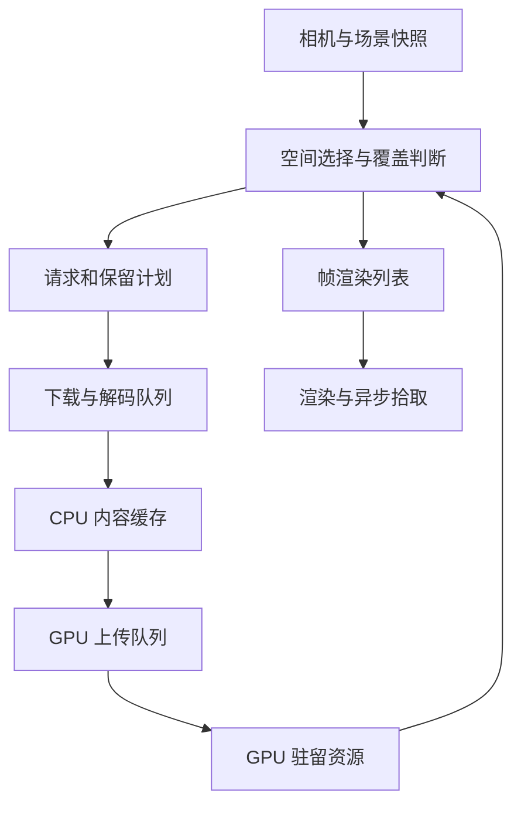

# Cesium Rust wgpu 实现方案

> **2026-10-21 现状评估与后续执行计划已更新：**请先阅读 [项目现状、完整复刻路线与 wgpu 优化方案](docs/roadmap-2026-10-21.md) 及 [剩余 252 项案例清单](docs/sandcastle-backlog-2026-10-21.md)。当前为 0.0.26，历史基线完成 **57 / 309**；本地 Cesium HEAD 已有 **310** 项，新增案例与两项源码变化单独追踪。下一批优先设备恢复、性能基线、uniform 分页/批量上传与按需渲染，再推进通用功能。
>
> 以下保留初始架构方案；“从零开发”、阶段范围和周数是历史设计，不代表当前进度或完整复刻的最终边界。当前任务优先级与验收标准以新版路线为准。本次仅更新分析与计划，未提升任何案例通过状态。

本方案用于从零开发 Rust 三维地球与 3D Tiles 引擎，工作名为 `cesium-rs`。图形层统一使用 wgpu，着色器统一使用 WGSL；原生通过 wgpu 的 Vulkan、Metal、DirectX 12 等可用后端运行，浏览器通过 WASM 与 WebGPU 运行。场景和数据运行时由 Rust 实现。兼容目标分成数据格式、场景行为和应用接口三层，通过能力清单逐步交付。

工程直接使用 wgpu 的 Device、Queue、Buffer、Texture、BindGroup、RenderPipeline、ComputePipeline 和 CommandEncoder，不另建覆盖全部图形 API 的通用 HAL。只抽象场景需要的资源句柄、上传队列和帧计划。第二十一章给出 wgpu 实现的资源布局、管线、上传和拾取契约，是渲染器落地的具体依据。

首版应交付能够稳定加载真实资产的 3D Tiles 查看器：正确处理坐标和材质，按视角加载，加载延迟时保留可用覆盖，支持属性拾取，在有界资源预算内持续运行。地形、影像、时序实体、高级样式和 GPU 批处理在此基础上扩展。

以下接口与代码用于确定设计契约；依赖版本需在工程启动时锁定，接口片段不构成完整可编译引擎。周期和性能数字是规划起点，需要首阶段基准验证。

## 一 项目定位与交付边界

### 1.1 三种兼容目标

| 层次 | 定义 | 交付依据 |
| --- | --- | --- |
| 数据兼容 | 识别并正确解释指定规范版本、内容格式和扩展 | 能力清单、标准资产、边界资产和拒绝行为 |
| 行为兼容 | 在指定场景中提供与 CesiumJS 相近的加载、时间、样式、相机和拾取行为 | 固定相机与时间的语义对照测试 |
| API 兼容 | 应用调用接口与指定 CesiumJS 版本具有约定映射 | 单独维护的 JS 适配层与迁移测试 |

Rust 核心 API 不照搬 JavaScript 对象模型。首版提供类型明确的 Rust API 和薄 JS SDK；确有迁移需求时再实现 CesiumJS API 子集适配。渲染器不要求逐像素复刻 CesiumJS。

### 1.2 分阶段能力矩阵

| 能力 | V0.1 核心查看器 | V0.2 GIS 扩展 | V1.0 增强版 |
| --- | --- | --- | --- |
| WGS84、ECEF、ENU、透视相机 | 完整基础链路 | 地形相机碰撞 | 扩展投影和业务坐标适配 |
| 3D Tiles 显式树 | 1.0/1.1 公共树语义、ADD/REPLACE、外部 tileset、空节点 | 多内容选择策略 | 隐式瓦片、subtree availability |
| 3D Tiles 内容 | b3dm、直接 GLB、pnts 基础语义 | i3dm、cmpt | 扩展压缩与元数据能力 |
| glTF 2.0 | 静态模型、核心材质、外部资源、sparse accessor | 常用扩展、实例 | 按需求加入蒙皮、动画等 |
| 属性与拾取 | Batch Table、稳定 feature ID、整数 ID 拾取 | EXT_mesh_features 与结构化元数据的声明子集 | 元数据继承、统计、业务查询 |
| 地形 | WGS84 椭球和默认背景 | Quantized-Mesh、裙边、可用性与回退 | 更完整的扩展与高程查询 |
| 影像 | 可选调试底图 | TMS、XYZ、WMTS、WMS 的明确子集 | 多源融合、调色、时间影像 |
| GeoJSON | 暂不作为发布门槛 | 点线面、样式、基础贴地 | 复杂几何与批量编辑 |
| CZML | 暂不作为发布门槛 | Clock、position、orientation、availability 子集 | 按属性逐项扩充 |
| 渲染 | PBR 基础、Reverse-Z、CPU 剔除 | 批处理、实例、按能力启用 GPU 剔除 | 间接绘制、遮挡、效果扩展 |
| 平台 | 桌面与 WASM 从第一阶段共同验证 | Web Worker 解码 | 按平台优化与恢复增强 |

“支持 3D Tiles 1.1”必须附支持范围，不能因为能读 GLB 就宣称全规范兼容。未知必需扩展应明确失败；未知可选扩展只有在核心表达仍有效时才允许忽略，并产生诊断。

### 1.3 Rust 实现的定义

引擎自有的空间数学、调度、格式适配、场景和渲染组织使用 Rust，着色器使用 WGSL，浏览器宿主胶水使用 JavaScript。Draco、Basis Universal 等编解码器单独标明实现来源。

若产品要求依赖链也完全不包含 C/C++ 或其 WASM 模块，应为压缩扩展设单独能力限制，并验证 Rust 实现的正确性与维护成本；不能在启用外部编解码器后继续宣称整个依赖链纯 Rust。Cesium Native 可作为语义和算法参考，不作为默认 FFI 核心。

## 二 核心架构与数据流

### 2.1 模块划分

| 模块 | 职责 | 不承担的职责 |
| --- | --- | --- |
| math / geometry | 椭球、坐标转换、包围体、相交、投影 | 网络和 GPU 资源 |
| formats / gltf / metadata | 验证、解码、统一内容表达、属性查询 | 每帧可见性选择 |
| streaming | 资源请求、取消、重试、预算、缓存、任务排队 | 实际绘制 |
| tiles / terrain / imagery | 各自的空间层级、选择语义和覆盖策略 | 平台执行器实现 |
| renderer | GPU 上传、资源句柄、管线、绘制、拾取读回 | HTTP 和 tileset 树维护 |
| scene | 图层组合、相机、时钟、帧协调、公共 API | 格式特例直接进入 shader |
| platform | 原生和 Web 网络、任务、文件缓存、surface | 格式语义 |

瓦片、地形和影像可以复用请求及缓存设施，但不应共用一套强行统一的 LOD 语义。3D Tiles 是任意显式或隐式树；地形通常是空间分块；影像层级与地形层级不必相同。



下载和解码异步进行；场景状态、瓦片树变更及渲染命令组装由单一所有者提交。异步任务返回不可变结果和 generation 标识，避免跨线程修改树结构。

### 2.2 Cargo Workspace

```text
cesium-rs/
  Cargo.toml
  Cargo.lock
  crates/
    cesium-math/
    cesium-geometry/
    cesium-formats/
    cesium-gltf/
    cesium-metadata/
    cesium-streaming/
    cesium-tiles/
    cesium-terrain/
    cesium-imagery/
    cesium-vector/
    cesium-time/
    cesium-renderer/
    cesium-scene/
    cesium-platform-native/
    cesium-platform-web/
    cesium-sdk/
  bindings/web/
  examples/desktop-viewer/
  examples/web-viewer/
  tools/asset-inspector/
  tests/fixtures/
  tests/conformance/
  tests/scenarios/
  tests/render/
  benches/
  docs/architecture/
  docs/capabilities/
```

早期可先合并关联模块，以上是职责边界而非要求第一周创建全部 crate。依赖方向保持 formats、math 不依赖 renderer；scene 可以依赖各层；platform 实现核心抽象。

### 2.3 依赖与版本策略

| 用途 | 候选依赖 | 使用约束 |
| --- | --- | --- |
| GPU | wgpu、naga | 锁定经双端验证的版本，避免混用历史 API |
| 数学 | glam | 使用 DVec/DMat 和 Vec/Mat 明确区分精度 |
| 图结构 | slotmap | generation key；额外验证无环和深度限制 |
| 网络 | reqwest；web-sys fetch | 核心接口不暴露 tokio 类型 |
| 任务 | tokio；wasm-bindgen-futures；Web Worker | 分平台实现，Web 本地 future 不强制 Send |
| 解码 | serde、serde_json、bytes、gltf 候选 | 解析库不等于完整渲染支持 |
| 图像 | image 及可选压缩纹理适配 | 开启所需格式，限制尺寸和解压后预算 |
| 测试 | proptest、cargo-fuzz、图像比较库 | 算法名称、运行环境和阈值必须明确 |
| 可观测性 | tracing | token、签名 URL 和敏感属性需脱敏 |

首次技术验证后确定 Rust MSRV、wgpu/glam/winit 等版本和可选 feature 组合。应用与 CI 使用锁文件；库发布同时检查声明的版本范围。压缩能力按 feature 单独构建，记录各组合的体积和加载成本。

## 三 坐标系统与精度设计

### 3.1 统一约定

| 对象 | 约定 |
| --- | --- |
| 经纬度 | 内部弧度；SDK 明确提供 degrees/radians 两种构造器 |
| 长度 | 米 |
| 默认高程 | WGS84 椭球高；正高数据经显式模型转换 |
| 世界坐标 | 右手 ECEF，f64 |
| 局部坐标 | ENU 或资产自身局部系，附到 ECEF 的 f64 变换 |
| 矩阵 | 明确列向量约定；组合顺序以单元测试固定 |
| 视空间 | 右手，相机前方为负 Z |
| GPU 顶点 | 围绕资产局部原点的 f32 |
| 裁剪深度 | WebGPU 的 0..1；首版采用 Reverse-Z |

SDK 不把 GCJ-02/BD-09 当成 WGS84。数据源坐标、投影与高程基准属于 provider 配置；对源资产不明的情况显式诊断，避免展示结果看似正确而整体偏移。

### 3.2 必需数学能力

实现椭球面法线、Cartographic↔ECEF、ENU 框架、射线与椭球相交、相机朝向、包围体变换、日界线 region、透视和正交 SSE 所需几何。反算要处理极区、地心附近及高度极端值，明确非法输入行为。

box 的三组 half-axis 不能默认为单位轴；sphere 变换使用保守缩放上界。`region` 是地理经纬高包围体，不能作为普通局部 box 直接乘 tile.transform；变换规则应依据规范逐类型处理。[R1]

### 3.3 资产变换链

逐节点累乘父子 tile.transform，加入内容格式特有的 RTC、实例、轴变换以及 glTF 节点变换。对 b3dm、i3dm、pnts 分别建立变换路径，不复用一个未经验证的通用乘法顺序。

具体顺序以规范条款和测试资产固定：单位矩阵、父旋转子平移、RTC_CENTER、glTF Y-up 到瓦片坐标、非均匀缩放、负缩放、实例 ENU。加载边界只做一次轴转换，避免重复转换。

### 3.4 相机相对渲染

设资产局部顶点为 p，局部到 ECEF 的线性部分为 A，资产局部原点在 ECEF 的位置为 O，相机 ECEF 位置为 C，世界到相机的旋转为 R：

```text
q_eye = R × A × p + R × (O − C)
clip = P_reverse_z × vec4(q_eye, 1)
```

CPU 使用 f64 计算 `R×A` 和 `R×(O−C)`，随后转 f32 上传。GPU 不接收含数百万米平移的普通 world/view 矩阵，相机平移只应用一次。

```rust
// 设计片段：camera_to_ecef 是正交相机姿态，local_to_ecef 已合并资产变换。
fn make_relative_model_view(
    local_to_ecef: glam::DMat4,
    camera_ecef: glam::DVec3,
    camera_to_ecef: glam::DMat3,
) -> glam::Mat4 {
    let world_to_eye = camera_to_ecef.transpose();
    let linear = glam::DMat3::from_cols(
        local_to_ecef.x_axis.truncate(),
        local_to_ecef.y_axis.truncate(),
        local_to_ecef.z_axis.truncate(),
    );
    let origin = local_to_ecef.w_axis.truncate();
    let a = world_to_eye * linear;
    let t = world_to_eye * (origin - camera_ecef);
    glam::DMat4::from_cols(
        a.x_axis.extend(0.0), a.y_axis.extend(0.0),
        a.z_axis.extend(0.0), t.extend(1.0),
    ).as_mat4()
}
```

原始资产若使用绝对 ECEF 顶点，在解码时先以 f64 重定位至局部原点。此过程不能恢复文件在编码成 f32 时已经丢失的精度。过大内容按空间分块或选用 high/low 编码路径，不依赖一个巨大局部模型覆盖全球。

法线矩阵从相应线性变换的逆转置构造，光照方向使用相同空间。奇异缩放报错或按明确降级策略处理。

high/low 和双浮点算术作为独立优化能力，用实际远距离误差决定是否引入；基础方案不宣称 GPU 原生或模拟 f64。

## 四 资产请求与可靠解析

### 4.1 解析契约

每个解析入口接收字节缓冲、原始 URL、资源限制和模式，返回结构化内容或带位置的错误。禁止对外部长度 unchecked 加减乘，禁止以输入驱动的切片索引 panic，禁止无限递归。

默认严格模式遵守声明的文件边界和必需字段。兼容模式按带名称的规则处理经过验证的历史资产问题；每次修复产生诊断。未知厂商变体不靠 magic 猜测后静默吞错。

```rust
pub struct DecodeLimits {
    pub max_input_bytes: usize,
    pub max_decoded_bytes: usize,
    pub max_vertices: usize,
    pub max_indices: usize,
    pub max_texture_dimension: u32,
    pub max_composite_depth: u32,
    pub max_json_depth: u32,
}

pub struct ByteRange {
    pub offset: usize,
    pub length: usize,
}

fn checked_range(
    data: &[u8], offset: usize, length: usize,
) -> Result<&[u8], DecodeError> {
    let end = offset.checked_add(length).ok_or(DecodeError::Overflow)?;
    data.get(offset..end).ok_or(DecodeError::Truncated)
}
```

限制必须同时检查声明值和实际解码值；图片压缩小不代表解压内存小。内部可使用 `Bytes` 或 `Arc<[u8]>` 加范围；浏览器跨 Worker 传输走平台资源通道，不强求和原生拥有完全相同的内存表示。

### 4.2 3D Tiles 内容

| 格式 | 必须处理的内容 |
| --- | --- |
| b3dm | header、版本与长度、表区范围、BATCH_LENGTH、RTC_CENTER、JSON/二进制属性、内嵌 glTF |
| pnts | POSITION/POSITION_QUANTIZED、量化体积、RTC、颜色/法线和声明支持的批次语义 |
| i3dm | 实例位置、方向、缩放、ENU、批次信息、内嵌或外链 glTF |
| cmpt | 子内容类型、长度、计数与嵌套限制，禁止循环资源引用 |
| GLB/glTF | 结构校验与资源解析；交给独立 glTF 模块 |
| tileset JSON | 版本、树结构、bounds、transform、refine、content(s)、外部引用和扩展 |

Feature Table 二进制引用和 Batch Table 属性布局需校验 offset、组件类型、数量与对齐。BATCH_LENGTH 使用检查转换；缺失或类型错误不能默认零后当作合法数据。所有内容偏移以声明 tile 字节区间为边界。

资产 inspector 提供 validate、inspect、capabilities 三类命令，显示元数据、引用、坐标范围和失败原因，方便在引擎加载前区分数据问题与渲染问题。

### 4.3 glTF 加载子系统

glTF 子系统完成 buffers、bufferViews、accessors、stride、normalized、sparse、节点和 primitive 的解释；支持无索引及声明范围内的 primitive mode。三角带和扇形可转换成统一三角形表示，点线使用相应管线。

首版材质支持 metallic-roughness、base color、normal、occlusion、emissive、纹理坐标、sampler、OPAQUE/MASK/BLEND 和 doubleSided。颜色纹理与数据纹理区分 sRGB/linear；正确处理 tangent、法线贴图和负缩放绕序。缺法线或切线时使用约定的生成策略并计入解码预算。[R3]

外链 buffer/image、data URI 和 GLB BIN 共享资源解析器。相对资源以实际解析上下文为基准；重定向、外部 tileset 和鉴权参数传递都有明确策略，禁止无条件向不同来源复制凭据。

扩展按优先级加入：KHR_materials_unlit、KHR_texture_transform、KHR_mesh_quantization、EXT_meshopt_compression、KHR_draco_mesh_compression、KHR_texture_basisu、EXT_mesh_gpu_instancing、EXT_mesh_features、EXT_structural_metadata。各扩展单独维护解析、渲染与 WASM 能力状态，不把“保留 JSON”当作支持。

### 4.4 统一 CPU 内容表示

```rust
pub struct DecodedContent {
    pub primitives: Vec<DecodedPrimitive>,
    pub materials: Vec<Material>,
    pub textures: Vec<TextureSource>,
    pub instances: Vec<InstanceSet>,
    pub metadata: MetadataStore,
    pub local_origin_ecef: glam::DVec3,
    pub decoded_bytes: usize,
}
```

实际结构需支持属性与实例共享、零复制视图和 lazy metadata；不要求所有原始属性都展开为 Vec。content 的坐标锚点和变换由统一类型表达，不能出现多个含义不明的 rtc_center 字段。

## 五 瓦片树与生命周期

### 5.1 树和内容分离

```rust
pub enum Refine { Replace, Add }

pub enum ContentState {
    Unrequested,
    Queued,
    Downloading,
    Decoding,
    CpuReady,
    UploadQueued,
    GpuReady,
    RetryWait,
    PermanentFailure,
}

pub struct TileNode {
    pub parent: Option<TileKey>,
    pub children: Vec<TileKey>,
    pub bounds: BoundingVolume,
    pub content_bounds: Vec<Option<BoundingVolume>>,
    pub world_transform: glam::DMat4,
    pub geometric_error_world: f64,
    pub refine: Refine,
    pub contents: Vec<ContentKey>,
    pub topology_state: TopologyState,
}
```

空内容节点没有虚构的 GpuReady 状态；外部 tileset 及隐式 subtree 的拓扑可用性与渲染内容可用性分离。多内容的就绪条件由角色决定：必要内容、可选覆盖层、互斥表达，不能一律等所有内容完成。

### 5.2 标识和异步提交

所有异步任务持有 `(scene_epoch, content_key, request_generation)`。提交前验证图层仍存在、content key 仍有效、generation 与设备 epoch 匹配。重新加载、取消、卸载和设备恢复使旧结果失效；过时结果释放预算并记录事件。

SlotMap key 不替代任务 generation。外部引用循环按规范化资源身份检测；父子连接检查祖先关系与最大深度。遍历使用显式栈或受控深度，避免恶意深树耗尽调用栈。

### 5.3 内存与上传预算

分别统计下载中、压缩缓存、CPU 解码内容、GPU 几何、GPU 纹理、上传 staging、拾取读回和 shader/pipeline 缓存。任务入队前预留预算，结果提交后用实际量调整；预算不足执行背压。

初始桌面预设可从 GPU 512 MiB、CPU 解码 512 MiB、压缩缓存 128 MiB 开始，Web 使用更低预设并允许应用设置。数值只是压测起点；WebGPU 无法可靠给出整机可用显存，不能把估计值当作真实硬件上限。

每帧上传设置字节、任务数量和 CPU 时间上限；对大资源分段上传。淘汰采用预算约束 LRU/分级优先级，pin 当前渲染集、必要回退祖先、在途使用资源。GPU 释放须尊重提交完成或 wgpu 的资源生命周期契约，自建内存池不能过早复用。

## 六 可见性 SSE 与覆盖选择

### 6.1 可见性层次

先做 tile bounds 的保守视锥剔除，再处理 viewerRequestVolume、地球地平线剔除及 content bounds。地平线剔除仅在适用条件下启用；地下或特殊高度场景不得沿用地表假设。遮挡不是地平线剔除的替代。

使用 CPU f64 执行世界空间可见性，或在局部化后使用误差可控的数学。bounds 与 geometric error 的缩放按资产变换处理。非均匀缩放需要保守上界，不能只取任意一轴。

### 6.2 SSE

透视相机基础模型：

```text
SSE = geometric_error_world × viewport_height_pixels
      / (2 × tan(vertical_fov / 2) × distance_to_bounds)
```

距离使用相机到包围体的距离，设置 epsilon，处理相机在包围体内的情形。viewport 使用实际渲染像素尺寸，明确与 CSS 像素和 devicePixelRatio 的关系。

正交相机使用世界单位到屏幕像素的比例；不套透视距离公式。初始最大 SSE 可取 16 像素并暴露配置。加入细化/合并不同阈值和短期保持，减轻边界抖动；动态 SSE 与跳级在正确基础遍历后实现。

### 6.3 覆盖状态

`GpuReady` 表示一个内容可画；`CoverageComplete` 表示当前需要的可见区域已有可用表达。两者不可互换。

```rust
pub struct SelectionResult {
    pub draws: Vec<DrawCandidate>,
    pub requests: Vec<RequestCandidate>,
    pub retain: Vec<ContentKey>,
    pub coverage: CoverageStatus,
}
```

覆盖不能仅从 box 的几何并集证明：bounds 是保守包围体，不是可渲染覆盖的精确边界。对 REPLACE，使用资产层级所表达的替换关系；不掌握内容覆盖契约时采用更保守的整组细化，而不是凭包围体认定没有孔洞。

### 6.4 REPLACE 的事务式选择

以下是算法设计伪代码，真实实现需覆盖外部树、多内容和拓扑未解析情况：

```text
select(node):
    若保守判定不涉及当前可见需求:
        返回空 draw 和 Complete

    收集此节点内容、拓扑的必要请求
    评估此节点自有内容是否可作为当前需求的替换覆盖

    若需要细化，或节点没有自有内容:
        在临时候选列表中选择相关子树
        若子拓扑完整且所需子树均可覆盖:
            提交临时候选 draw
            返回 Complete
        若自有内容可覆盖:
            丢弃不能安全混画的子 draw；保留子请求
            pin 自有内容并返回父 draw 和 Complete
        返回子候选、Incomplete，交给上层决定是否提交或回退

    若自有内容可覆盖:
        返回自有 draw 和 Complete

    尝试已经驻留的更细子树作为临时表达
    若它们覆盖成立:
        返回子 draw 和 Complete
    返回 Incomplete 并向祖先传播
```

在普通整组替换策略下，上层采用父回退时撤销对应子候选，避免同一覆盖区域父子重叠。若需要部分子覆盖加父兜底，必须设计 stencil、裁剪或空间覆盖掩码；默认不混画。

不可见子树不应阻塞必要可见覆盖，但仅在保守剔除可信、拓扑已知、当前替换关系有效时才能排除。永久失败的相关子内容保留父回退，并显式显示诊断。

### 6.5 ADD 的选择

ADD 内容是逐级补充，自有可见内容和子内容独立选择；不因子完成而删除父。父内容失败时仍可画可用子内容，但整体声明的内容可能缺失，不能把它统计为完整语义覆盖。ADD 的缓存 pin 和预算需要控制累积内容量。

### 6.6 无孔洞保证的边界

保证针对已具备可用祖先表达、合法层级及必要资源仍可驻留的替换式加载过渡。首次加载无任何内容、根数据错误、内容本身有缺口、所有覆盖均失败或设备不可用时，客户端无法创造不存在的覆盖。

地形可用椭球背景兜底，但这只是背景连续，不等于真实地形高程完整。验收需区分加载导致的缺口、资产几何缺口和视锥裁剪错误。

## 七 流式请求调度

### 7.1 请求优先级

优先解决当前覆盖缺口，其次完成可见细化，再进行短距离预测预取。优先级由覆盖紧迫度、SSE 超限量、距离、相机运动和等待时间组成；加入老化避免饥饿。最初使用可解释的离散优先级，再通过压测调整权重。

下载、解码、上传各自独立队列。初始并发可设桌面下载 16、浏览器下载 8，并根据域名、资源大小和环境配置；不把固定并发作为性能保证。相同 URL/鉴权上下文/请求参数共享任务和缓存。

### 7.2 取消重试和缓存

相机运动使任务过时后，按资源成本取消低价值下载，允许即将完成的解码进入受限缓存。Abort 与任务 generation 共同防止过时提交。已经排进 GPU 的命令不能当作普通 future 取消，只取消后续使用。

429/5xx 和临时网络错误按 Retry-After、指数退避和抖动重试；身份失败等待 provider 刷新；格式错误和不支持的必需扩展为永久失败。404 在隐式可用性和普通文件场景中按不同策略处理，不能统一无限重试。

缓存 key 包含资源身份、影响内容的 headers、变体和授权作用域，日志不记录凭据。原生可实现磁盘缓存，Web 通过可选 IndexedDB/Cache Storage 适配；核心只依赖缓存接口。HTTP 缓存与自有缓存要有一致的新鲜度策略。

## 八 地形子系统

### 8.1 Quantized-Mesh 完整流程

读取 terrain provider 元数据，明确地理或投影 tiling scheme、level zero 布局、Y 方向、可用性、URL 模板和扩展协商。HTTP 解压与文件解析区分，避免双重 gzip 解压。

解析 header、vertexCount、u/v/height 差分数组、索引对齐、16/32 位 high-water-mark 三角索引、四条边索引和扩展。差分使用 i32 累加并验证 0..32767；索引检查下溢、顶点范围、数量乘法和文件边界。[R2]

```rust
fn decode_quantized_values(encoded: &[u16]) -> Result<Vec<u16>, TerrainError> {
    let mut out = Vec::with_capacity(encoded.len());
    let mut value = 0_i32;
    for &code in encoded {
        let delta = ((code >> 1) as i32) ^ -((code & 1) as i32);
        value = value.checked_add(delta).ok_or(TerrainError::Overflow)?;
        if !(0..=32767).contains(&value) {
            return Err(TerrainError::InvalidQuantizedValue);
        }
        out.push(value as u16);
    }
    Ok(out)
}
```

顶点经 tile rectangle 和 min/max height 恢复到地理位置，再围绕局部原点转 ECEF。无显式法线时生成几何法线；支持的 oct-normal、watermask、metadata 扩展逐项验证，未知可选扩展按长度安全跳过。

### 8.2 裙边与接缝

按四条边索引排序和绕序生成下垂顶点，裙边下降沿相应地理局部高程方向，不沿全局 Z。裙边深度由层级误差和相邻 LOD 策略决定，扩展 bounds 并正确排除不适合拾取的裙边。

保留父地形作为加载回退；首版可使用整组替换，若要局部父补洞则提供明确的空间掩码。相邻 LOD 差约束、边界 stitching 和 geomorph 可在后续减少裙边露出。裙边主要遮挡裂缝，不等价于拓扑连续。

高度查询返回数据来源、精度层级和 pending 状态。碰撞采用安全高度及已有粗层高程，避免细地形突然到达时相机穿入。

## 九 影像与 GIS 图层

### 9.1 Provider 抽象

影像 provider 描述 CRS、矩阵集、覆盖范围、级别、tile size、axis order、行列方向、鉴权及 attribution。TMS/XYZ 的 Y 翻转、WMTS 的 TileMatrix 标识与 limits、WMS 的版本/CRS 轴序分别实现。

先支持明确的 EPSG:4326 与 EPSG:3857 路径。WMTS 不默认是 `2^z` 方阵；业务服务依据 GetCapabilities 和配置生成请求。影像经度跨日界线切分，并处理 Web Mercator 的有效纬度范围。

### 9.2 地形影像映射

每块地形独立选择影像级别与覆盖 tile，计算 UV 矩形与投影映射；影像缺失时用可用祖先及正确 UV 子区间。影像和地形不要求同级。

GPU 按限制选择纹理数组、atlas 或多批绘制。多图层设置顺序、opacity、颜色调整和 sampler；mipmap/atlas 边界留边防止串色。服务 key 由应用注入，不写入代码仓库。

### 9.3 GeoJSON

实现 Feature/FeatureCollection、Point/MultiPoint、LineString/MultiLineString、Polygon/MultiPolygon 的声明子集。几何处理覆盖闭环、洞、日界线、重复点和三角化失败。高度模式区分 absolute、relative-to-ground、clamp-to-ground，查询与更新可异步。

粗长线段按椭球曲线分段，屏幕线宽使用相应几何管线；点与标签分开。标签需要字体加载、字形 atlas、布局和碰撞预算，是独立任务，不能附带在简单点绘制中承诺完成。

## 十 渲染系统

### 10.1 Reverse-Z 投影

固定右手视空间，近距离 n>0，物体在相机前方 z<0，无限远投影的核心关系为 `z_clip=n`、`w_clip=-z_eye`，所以 `depth=n/(-z_eye)`。

```rust
// 列主序矩阵。使用前验证 fovy、aspect 和 near，避免非法矩阵。
fn reverse_z_infinite_rh(fovy: f32, aspect: f32, near: f32) -> glam::Mat4 {
    let f = 1.0 / (0.5 * fovy).tan();
    glam::Mat4::from_cols(
        glam::Vec4::new(f / aspect, 0.0, 0.0, 0.0),
        glam::Vec4::new(0.0, f, 0.0, 0.0),
        glam::Vec4::new(0.0, 0.0, 0.0, -1.0),
        glam::Vec4::new(0.0, 0.0, near, 0.0),
    )
}
```

深度附件优先 Depth32Float，clear=0，比较 GreaterEqual，不透明/MASK 开启深度写入。正交投影另建反向有限远矩阵。near 根据相机场景约束配置，避免取不必要的小值。

阴影图、深度重建、Hi-Z、拾取反投影和偏移的约定分别写测试。Reverse-Z 改善深度分布，无法消除真正共面的表面冲突；覆盖层仍需正确的几何偏移、深度偏移或专用绘制策略。

### 10.2 帧通道

首版流程为资源提交、GPU 上传、背景/椭球、不透明及 MASK、透明排序、选中高亮、按需 ID 拾取、读回排队和呈现。后续增加深度预通道、阴影、Hi-Z 和后处理前，先用测量证明收益。

BLEND 默认近似排序、通常关闭深度写入；复杂交叉透明的限制写入能力清单。地形、点云、实例、线和普通网格使用各自管线。点云点大小需求可使用实例化 billboard/quad，避免依赖不存在的可编程 point-size 行为。

### 10.3 GPU 数据布局

global 数据包含投影、太阳方向、时间和曝光；tile/instance 数据包含相机相对变换、法线矩阵、材质及 feature 映射；资源按 material/texture 分组。所有 Rust→WGSL 布局显式确定 padding 和 alignment，动态 uniform offset 遵守设备查询值。

```wgsl
struct TileUniforms {
    model_view_relative: mat4x4<f32>,
    projection: mat4x4<f32>,
};
@group(0) @binding(0) var<uniform> tile: TileUniforms;

struct VertexInput {
    @location(0) position: vec3<f32>,
    @location(1) feature_id: u32,
};
struct VertexOutput {
    @builtin(position) position: vec4<f32>,
    @location(0) @interpolate(flat) feature_id: u32,
};
@vertex fn vs_main(v: VertexInput) -> VertexOutput {
    var out: VertexOutput;
    out.position = tile.projection * tile.model_view_relative * vec4<f32>(v.position, 1.0);
    out.feature_id = v.feature_id;
    return out;
}
```

此片段仅说明精度和离散 ID 的接口，实际材质管线还需 UV、法线、切线、颜色与实例输入。整数阶段间 ID 使用 flat 插值，不能使用默认插值的 f32 批次 ID。[R5]

### 10.4 渐进 GPU-Driven

基础路径：CPU 语义选择和剔除，GPU 正常绘制；优化路径：CPU 仍负责流式需求与覆盖，GPU 对驻留 primitive/instance 执行局部剔除和绘制组织。

统一 FrameDrawList 表达 primitive、instance、material、bounds、feature 范围。先按材质排序和实例批处理，再使用 storage buffer、compute 和间接绘制。multi-draw、纹理绑定数量、压缩格式等按 adapter features/limits 启用，始终保留可用降级路径。

遮挡剔除使用 Reverse-Z 下经过验证的层级深度归约和保守比较；上一帧结果仅作为带失效规则的提示。相机快速移动、模型移动及历史失效时暂时放行，不能让遮挡结果导致新的加载孔洞。

## 十一 元数据 拾取与样式

### 11.1 元数据模型

提供统一 `FeatureRef`，包含 layer、content、primitive/instance 和 feature 标识，关联原始 Batch Table 或结构化元数据。支持标量、数组、字符串、布尔、二进制属性以及明确声明的缺省、noData、offset/scale 语义。

元数据按需解析，样式读取只展开涉及字段。保持 ID 整数精度；超过 JS 安全整数范围使用字符串或 BigInt 接口，不通过浮点传输。

### 11.2 GPU 拾取

使用非 MSAA 的 R32Uint ID attachment 或经验证的整数编码路径；分配帧内 pick ID 到稳定 FeatureRef 的映射。以拾取帧的快照解析结果，不能用下一帧重新编号后的映射。

拾取 pass 与可见 pass 共享变换、剔除及 MASK discard 规则。明确透明选择策略、实例选择和不可拾取内容。屏幕坐标从 CSS 转到实际像素，并处理 Canvas resize、DPR 与视口位置。

按点击需求绘制小 scissor 区域和异步读回，遵守 GPU copy 行对齐。读回保留 frame ID、camera snapshot、scene generation；图层已卸载时返回失效状态。默认不执行每帧全屏同步读回。

世界位置查询使用对应深度读回/独立路径；无限远背景 depth=0 单独处理。ID 拾取与地形高度查询是不同 API。

### 11.3 样式和高亮

首版样式支持按属性的显示、颜色和选中状态。后续建立受限 AST 表达式解释器，明确数字、字符串、null 和错误语义，不执行任意 JavaScript。样式变更使用脏范围上传，避免每帧重建全部几何。

高亮可先覆盖选中 feature 的颜色；描边是后续渲染能力，需评估深度和透明场景表现。属性存储到拾取再到高亮构成独立端到端验收。

## 十二 时钟 实体与 CZML

Clock 支持 current/start/stop、multiplier、暂停、循环和按需渲染。时间表示区分 UTC、TAI、TT 等需求和闰秒表版本；禁止把所有 JulianDate 运算简化成一个不带时间标准的 f64。

CZML 是 JSON 数据模型，单独模块处理 packet、id/delete、availability、reference、epoch、采样 position/orientation 和声明的插值算法。首版支持 fixed 坐标系；inertial 转换需相应模型与数据，未实现前明确拒绝。

Entity 将属性求值与可绘制表达分开，时间跳跃、区间边界、引用循环、缺采样和删除有明确行为。插值默认线性及 quaternion slerp 子集，高阶插值按算法逐项加入。轨迹、模型、billboard、label 等分别维护能力，不能“能读 CZML”就承诺全实体兼容。

## 十三 相机与场景公共接口

相机支持地球轨道、平移、缩放、自由飞行、lookAt、flyTo、地形安全高度和拾取辅助定位。flyTo 以包围体和视口估算距离，覆盖近远、极区、日界线和用户中断。

所有控制以 f64 世界位置及明确姿态运行；输入使用单调时间而非渲染帧数，避免不同帧率改变操作速度。相机控制与具体 winit/DOM 事件绑定分离。

```rust
// API 设计示意：内部 future/句柄和错误类型在 SDK 阶段确定。
let mut viewer = Viewer::new(surface, ViewerOptions::default()).await?;
let layer = viewer.add_tileset(url, TilesetOptions::default()).await?;
viewer.fly_to_layer(layer, FlyToOptions::default())?;
let picked = viewer.pick(screen_position).await?;
viewer.remove_layer(layer)?;
```

add_tileset 的完成条件定义为根描述与必要拓扑可用，不是全量数据加载完成。提供 progress/event 查询首个可见覆盖、网络失败、能力缺失和稳定帧。remove_layer 取消请求、释放 pin 和资源，旧事件不得继续影响新图层。

FramePlan 由每帧快照生成，render 返回提交结果。按需渲染在相机、时间实体、加载、样式、动画等变化时触发；空闲暂停调度，后台浏览器降低工作量。

## 十四 原生与 WASM 平台实现

### 14.1 平台抽象

核心依赖 ResourceFetcher、TaskExecutor、ContentCache、ClockSource 等接口。原生 Fetcher 使用 Send future；Web 允许 local future，使用 cfg/type alias 或分别编译的实现，不把 tokio runtime 和 Send + Sync 约束泄漏到所有核心对象。

网络返回 bytes、状态、最终 URL、缓存信息和资源身份；浏览器 Fetch 遵守 CORS 和宿主环境限制。原生大解码使用受限工作线程；Web 的 JSON 大解析、图片和压缩网格解码进入 Worker。

### 14.2 Web Worker 与内存

Worker 协议包括 task ID、generation、格式、限制、资源上下文、结果和错误；传输 ArrayBuffer 时明确 ownership transfer。跨线程共享 WASM 内存是可选能力，依赖宿主隔离配置；默认路径不要求 SharedArrayBuffer。

避免在 renderer 主线程集中解码或复制大资产。监控 WASM linear memory、JS ArrayBuffer、浏览器图像对象和 GPU 估算量；只检查 Rust allocator 不能代表总内存。

Web SDK 提供 attachCanvas、resize、destroy、addLayer、pick 和事件订阅，destroy 释放 Worker、事件监听、任务和 GPU 引用。检测 WebGPU、可用 adapter 和限制，报告明确不支持状态；WebGL 回退是单独项目范围，不暗示 wgpu 后端切换即可覆盖所有需求。

### 14.3 设备与 surface 恢复

surface 暂时不可用、窗口最小化、resize 和设备丢失分别处理。设备丢失后增加 device_epoch，停止旧上传和拾取结果提交，重新创建资源；优先从 CPU 缓存恢复当前覆盖，缺失内容重新请求。

pipeline 和 bind group key 包含设备 epoch 与相关格式；恢复不能复用旧设备 handle。无法恢复时向应用报告状态，并保留可重新创建 Viewer 的路径。

## 十五 性能 可观测性与诊断

至少展示 FPS/frame time、CPU 选择/解码/上传耗时、draw calls、可见 primitive、三队列长度、取消率、缓存命中、各类字节预算、覆盖缺口、回退瓦片数、请求错误和能力缺失。

调试覆盖层显示 tile bounds、geometric error、SSE、refine、状态和 pin 原因。记录固定相机轨迹与网络事件，可离线回放调度；诊断日志关联资源和任务，但脱敏授权信息。

性能指标使用 p50/p95/p99，区分冷缓存、暖缓存、加载期间和稳定场景。基准资产固定字节量、三角形、纹理、层级、压缩类型；网络固定带宽、RTT、丢包，硬件与浏览器固定版本。

可将桌面 1080p 稳态 p95 帧耗时 ≤16.7 ms、Web 基准场景 ≤33.3 ms 作为初始目标，但须由第一个闭环测量校准。下载等待不计入渲染 CPU 耗时，上传峰值和主线程长任务单独记录。

## 十六 测试与质量门槛

### 16.1 测试矩阵

| 测试层 | 必测内容 | 通过条件 |
| --- | --- | --- |
| 数学 | 极点、日界线、随机往返、射线、变换链、投影 | 与独立参考一致，按函数与条件设置误差 |
| 解析 | 正常、截断、溢出、非法引用、嵌套、压缩炸弹 | 不 panic、不越界、不突破资源上限 |
| 瓦片语义 | ADD/REPLACE、空节点、外部树、多内容、失败 | 选择和回退符合定义 |
| 调度 | 并发、取消、重试、重载、预算、淘汰 | 过时结果不提交，预算计数守恒 |
| 地形 | u/v/h、索引、边界、不同 LOD、可用性 | 几何正确，加载过渡满足覆盖条件 |
| 渲染 | 深度、材质、缩放、透明、ID、DPR | 固定案例图像和语义断言通过 |
| 平台 | Native、wasm32、真实浏览器、设备恢复 | 构建、加载、拾取、卸载端到端通过 |

数学 f64 基础运算可以采用亚毫米目标，但应附定义域和参考算法；GPU 画面误差用米或像素单独测量，不能由 ECEF 两个端点测试推导无抖动。

### 16.2 调度属性测试

生成小型树和随机任务完成顺序，断言：替换祖先作为回退时不会同时提交未经掩码的后代；可见已知需求有可用覆盖时不退成空集；空节点可继续遍历；永久失败不造成无界重试；pin 资源不被淘汰；任务 generation 和预算预留最终归还。

保存失败种子。构建显式 mock fetch/decode/upload 时钟，让测试可重放，不依赖真实网络完成顺序。

### 16.3 Fuzzing

按 b3dm、pnts、i3dm、cmpt、GLB、Quantized-Mesh、subtree、二进制元数据分别建 target。使用真实小资产作 corpus，限制进程内存和时间；监测 panic、异常分配、死循环和 parser 差异。

除原生 sanitizer fuzz，还需检查 wasm32 编译及 32 位长度计算边界；原生 64 位测试不会自动证明 WASM 加法安全。以覆盖率、累计 CPU 时间、corpus 和已修复缺陷衡量，不使用单个“20 万次”作为充分证明。

### 16.4 图像与语义回归

使用固定相机、时间、曝光、资源和随机种子。若使用 hybrid compare，就报告 hybrid score；若验收 SSIM，则使用对应 SSIM 算法。先统一颜色空间、尺寸、alpha 和比较区域。[R6]

全图相似度之外增加缺口区域、深度、feature ID、纹理 UV 和关键像素断言，避免大面积背景掩盖小而重要的错误。跨 GPU 不同基准或容差；软件 adapter 只能作为一条可控测试路径，不能覆盖所有硬件行为。

### 16.5 发布门槛

每个声明支持的格式和扩展均有正例、拒绝/降级例和双端验证；CI 执行 format、clippy、unit、integration、wasm build、shader validation 和浏览器 smoke。render 测试在固定 runner 运行，长时 fuzz 与压力测试按独立任务持续进行。

发布产物附 capabilities manifest、已知限制、基准资产说明、性能报告、迁移示例和第三方依赖说明。100% 通过仅指明确版本的测试集，不推导所有现实资产都兼容。

## 十七 实施路线与人员配置

以下按 4 人核心团队估算：图形/精度 1 人、格式/元数据 1 人、调度/平台 1 人、GIS/集成测试 1 人。成员可交叉承担任务；缺少成熟图形或地理经验时，应先增加技术验证时间。

| 阶段 | 参考周期 | 交付内容 | 退出条件 |
| --- | --- | --- | --- |
| P0 技术验证 | 第 1–2 周 | 双端三角形、局部 GLB、相机相对坐标、Reverse-Z、基准样本 | 双端可运行，变换和投影用例通过，依赖锁定 |
| P1 静态资产链路 | 第 3–6 周 | b3dm/GLB 基础、材质、树解析、资源解析器、诊断 | 相同资产双端定位和材质正确，异常输入可解释 |
| P2 流式与拾取 | 第 7–12 周 | REPLACE/ADD、空节点、外部树、预算、取消、pnts 基础、ID 拾取 | 受控网络轨迹通过，无过时提交和预算失控 |
| V0.1 发布加固 | 第 13–16 周 | Worker、恢复、测试集、压力测试、SDK、能力清单 | 核心查看器双端端到端验收通过 |
| P3 地形与影像 | 第 17–24 周 | Quantized-Mesh、裙边、基础 TMS/WMTS/WMS、相机碰撞 | 地形影像映射和 LOD 回退通过 |
| P4 格式与 GIS | 第 25–32 周 | i3dm/cmpt、元数据子集、常用压缩、GeoJSON、CZML 子集 | 每能力都有兼容测试与业务示例 |
| P5 优化与增强 | 第 33–44 周 | 隐式瓦片、GPU 批处理、常用样式、性能和迁移加固 | 目标资产与设备达到发布指标 |

该计划约 4 个月交付核心查看器，约 8–11 个月形成较完整 GIS 引擎，是规划估计而非规范事实。CesiumJS 的全部 API、标签布局、复杂动画、所有扩展和所有渲染效果没有纳入固定周期承诺。

阶段工作可以由团队并行推进，但 P0 的坐标与平台契约、P1 的内容表达、P2 的覆盖与预算是后续工作的硬依赖。浏览器验证贯穿全程，不作为最后一阶段移植。

## 十八 可直接进入任务系统的首批工作

| 顺序 | 任务 | 主要验收 |
| --- | --- | --- |
| 01 | Workspace、锁文件、双端示例、CI | Native/WASM 基础构建运行 |
| 02 | 坐标类型与 WGS84/ENU | 随机往返和极区边界 |
| 03 | 相机相对变换、Reverse-Z | 近远深度、平移重复应用检测 |
| 04 | ResourceFetcher、limits、generation | mock 取消和过时提交 |
| 05 | 安全 b3dm 拆包与 inspector | 截断、WASM 溢出、RTC、必需字段 |
| 06 | glTF accessor/节点/材质 | sparse、stride、缩放、外链纹理 |
| 07 | tileset 树语义 | refine 继承、bounds、空节点、外部树 |
| 08 | 事务式覆盖选择 | 父回退、部分失败、ADD 不丢父 |
| 09 | 请求/解码/上传预算与淘汰 | 计数守恒、pin、背压 |
| 10 | Batch Table 和整数拾取 | 属性→点击→高亮完整案例 |
| 11 | Worker 与设备恢复 | 浏览器主线程成本、epoch 校验 |
| 12 | 固定轨迹压测与发布清单 | 冷暖缓存报告、持续漫游、卸载 |

每项任务附输入资产、预期输出和不支持场景。首批工作只实现必要闭环，不用未落实的 GPU-Driven 名称替代可测量的正确性和性能。

## 十九 技术风险与处理决策

| 风险 | 表现 | 优先处理方式 |
| --- | --- | --- |
| 历史资产变体过多 | 合法与修复规则混杂 | 严格/兼容分离、版本化 fixture、inspector |
| ECEF/轴/RTC 混用 | 整体偏移、旋转、近景抖动 | 类型化坐标、变换链测试、相机相对约定 |
| 树语义不完整 | 空父停遍历、子失败卡住、父子重叠 | 拓扑与内容分离、覆盖返回值、事务选择 |
| 浏览器解码卡顿 | 长任务和操作停顿 | Worker、分帧提交、资源限制 |
| 内存峰值失控 | 多重复制、上传 OOM | 分级预算、预留、共享字节、背压 |
| 高级 GPU 特性不一致 | 部分设备验证失败 | features/limits 探测、基础渲染路径 |
| 包体和压缩扩展冲突 | 初始下载大、首次解码慢 | 可选模块、分包、按能力加载 |
| 坐标源不一致 | 底图与模型系统偏移 | provider 的 CRS/高程契约、显式转换 |
| 指标过度承诺 | 小样本通过而实景失败 | 固定设备、资产、网络、版本及 p95/p99 |

项目工作名与公开名称、许可证及上游引用在发布准备时确认，保留第三方编解码与资产授权信息，不把独立实现表述为官方 Cesium 产品。

## 二十 完成定义

V0.1 完成意味着：应用能在桌面和浏览器加载声明支持的 tileset；关键坐标和材质正确；相机漫游触发有优先级的请求；加载失败时保留可用覆盖；CPU/GPU 预算有界；点击返回正确属性并高亮；卸载和设备恢复不产生过时结果；发布清单与可执行测试保持一致。

V0.2 完成意味着：在上述基础上加入可验证的地形、影像、基础向量及时间能力，明确 CRS、LOD 接缝、图层映射和各数据模型的子集范围。

V1.0 完成意味着：针对约定业务资产、规范版本、平台和硬件完成兼容与性能验收，提供稳定 SDK 和升级策略。新增扩展或 CesiumJS API 属于后续能力增量，必须继续经过相同的验证流程。

## 二十一 wgpu 具体实现设计

### 21.1 渲染器代码组织

```text
cesium-renderer/src/
  context.rs              Instance、Adapter、Device、Queue、能力选择
  surface.rs              surface 配置、resize、呈现和暂时不可用处理
  capabilities.rs         features、limits、格式支持与渲染路径选择
  frame.rs                FramePlan 与命令录制
  resources.rs            MeshHandle、TextureHandle、MaterialHandle
  allocator.rs            GPU 缓冲页、分配、回收与使用记录
  upload.rs               几何、纹理、uniform 分帧上传
  uniforms.rs             Rust 与 WGSL 共享布局
  bind_groups.rs          布局、材质绑定、对象动态偏移
  pipeline_cache.rs       RenderPipeline 与 ComputePipeline 缓存
  picking.rs              ID attachment、拷贝、异步映射和帧内 ID 表
  passes/
    globe.rs
    opaque.rs
    transparent.rs
    point_cloud.rs
    highlight.rs
    pick.rs
    cull.rs               后续 compute 剔除
  shaders/
    common.wgsl
    pbr.wgsl
    terrain.wgsl
    point_cloud.wgsl
    pick.wgsl
    cull.wgsl
```

首版以显式 pass 顺序实现帧计划，不先开发复杂的通用 render graph。新增效果产生明确读写依赖后再引入图调度。wgpu 负责底层同步和后端差异；应用仍须确保资源 usage、绑定和自有分配器生命周期正确。

### 21.2 设备初始化契约

1. 创建 Instance，在原生指定允许的后端，在 Web 选择 WebGPU 路径。
2. 从原生窗口或 Canvas 创建 Surface；离屏测试可以不创建 Surface。
3. request_adapter 指定 compatible_surface，交互查看器不强制软件 adapter。
4. 读取 adapter.features、adapter.limits 和 surface capabilities，查询特殊纹理格式需求。
5. 构造引擎实际需要的 features 与 limits，验证全部请求得到支持；不用“开启所有支持的特性”替代需求声明。
6. request_device 后保存实际可用能力，创建布局与基础管线。初始化失败返回带阶段的错误。
7. 从 surface 可用格式中优先选择符合输出策略的 sRGB 格式，选择支持的 present/alpha mode，尺寸非零时配置。

wgpu API 随版本演进，工程启动时固定版本；例如本次查阅的 wgpu 30.0.1 文档中 request_device 接收一个 DeviceDescriptor 参数，不能混用旧示例中的第二个 None 参数。[R9]

Window/Canvas 的有效期必须覆盖 Surface。原生可使用该版本支持的 Arc<Window> 所有权创建方式；其他方式则显式管理 Surface 生命周期。不使用 unsafe 或伪造 static 生命周期绕开窗口约束。

窗口宽高为零时暂停获取帧；resize 重建深度、MSAA、拾取和后处理附件，并使旧尺寸的异步拾取请求失效。配置变更要避免与未完成的旧 surface texture 使用冲突。

### 21.3 渲染能力等级

| 路径 | 内容 | 启用条件 |
| --- | --- | --- |
| 基础 | CPU 选择、普通 draw_indexed、每材质 bind group | 满足基础 WebGPU 与引擎实际限制 |
| 实例批处理 | 共享几何、多实例矩阵和属性 | 实例及 buffer 数量符合限制 |
| compute 剔除 | storage buffer、compute、普通 indirect | 对应 usage、limits 和所用间接参数可用 |
| 原生增强 | 多重间接绘制、可变 draw count、绑定数组 | 明确查询并申请对应可选 feature |

基础路径不依赖 bindless、shader f64、mesh shader、可变 draw count 或特殊纹理过滤。texture_2d_array 是一个分层纹理对象，与 texture binding array 是不同概念，不能混用能力判断。

multi_draw_indirect_count 在当前查阅文档中属于原生特性；浏览器不能以该接口作为必经路径。开启 compute 后仍保持固定数量 indirect 命令的降级方式，剔除结果通过 instance_count=0 表示，避免为了得到 draw 数量而每帧读回 CPU。[R10]

### 21.4 BindGroup 与 uniform 布局

第十章的 shader 是最小变换示意，正式实现采用以下分组，避免每个对象重复上传投影和全局光照：

| group | binding | 内容 | 使用方式 |
| --- | --- | --- | --- |
| 0 | 0 | GlobalUniform，投影、视空间太阳方向、视口参数 | 每帧更新 |
| 1 | 0 | ObjectUniform，相机相对 model-view、法线矩阵、ID 参数 | 动态 uniform offset |
| 2 | 0 | MaterialUniform，PBR 因子和 alpha 参数 | 材质变更更新 |
| 2 | 1..N | baseColor/normal/metalRough 等纹理及 sampler | 按材质绑定，缺失时用默认纹理 |

```rust
// 所有字段显式匹配 WGSL；可使用 bytemuck Pod/Zeroable 派生。
#[repr(C, align(16))]
pub struct GlobalUniform {
    pub projection: [[f32; 4]; 4], // 64 bytes
    pub sun_direction_eye: [f32; 4],
    pub viewport_exposure: [f32; 4],
} // 96 bytes

#[repr(C, align(16))]
pub struct ObjectUniform {
    pub model_view_relative: [[f32; 4]; 4],
    pub normal_col0: [f32; 4],
    pub normal_col1: [f32; 4],
    pub normal_col2: [f32; 4],
    pub feature_params: [u32; 4],
} // 128 bytes
```

mat3 的三列使用 vec4 存储，GPU 取 xyz，不把 Rust 连续 9 个 f32 直接当作 uniform mat3。增加 sizeof/offset 断言和 shader layout 验证。

ObjectUniform 的 slot stride 为按 device.limits().min_uniform_buffer_offset_alignment 向上取整后的大小，bind group 的 binding size 为对象结构大小，min_binding_size 显式设置。动态 offset 超出 u32 或 buffer 超出设备限制时分页，不能静默截断。

对象数过大时可以改用 storage object table，但要额外查询限制并提供与基础布局分别编译的管线，不假设所有设备都有无限绑定空间。

### 21.5 顶点 索引与缓冲用途

静态 mesh 的推荐首版布局为 position Float32x3、normal Float32x3、uv Float32x2、feature_id Uint32，共 36 bytes，偏移依次 0、12、24、32。VertexBufferLayout 按此声明。顶点输入布局与 uniform 布局不同，不需要把每个 vec3 按 16 bytes 扩充。

glTF 多 UV、颜色、切线和无某属性的情况采用经规范化的额外布局或有限管线变体。feature_id 为离散整数，实例 feature 和顶点 feature 按内容格式分别解析。

| GPU 资源 | usage |
| --- | --- |
| 顶点缓冲 | VERTEX，流式写入时加 COPY_DST |
| 索引缓冲 | INDEX，流式写入时加 COPY_DST |
| 全局/对象/材质 uniform | UNIFORM \| COPY_DST |
| compute 对象/实例表 | STORAGE，按更新方式加 COPY_DST |
| GPU 生成间接参数 | STORAGE \| INDIRECT，初始化时可加 COPY_DST |
| staging 上传页 | MAP_WRITE \| COPY_SRC；首版也可用 Queue 写入 |
| 拾取读回页 | MAP_READ \| COPY_DST |
| 普通纹理 | TEXTURE_BINDING \| COPY_DST；生成 mip 时额外配置所需 usage |
| ID 纹理 | RENDER_ATTACHMENT \| COPY_SRC |

首版几何可每内容独立 buffer，预算统计清晰后再加入分页池。池化时句柄包含 page、offset、length、generation；资源被淘汰与区域可以复用是两个时间点。提交完成前不复用仍被命令引用的区域。

### 21.6 上传队列

小型 uniform 与少量几何使用 Queue::write_buffer，普通图像可使用 Queue::write_texture。大型上传采用 staging 页与 CommandEncoder copy，在下一次提交前完成记录。

纹理必须校验尺寸、mip、层数、块压缩对齐和解码字节预算。CommandEncoder 的 buffer↔texture copy 在给出 bytes_per_row 时要求其满足 256 字节倍数；Queue::write_texture 没有这个行距要求，不能无差别给所有图像增加 padding。[R11]

每个上传任务可返回 Pending、Submitted 或失败；Submitted 对应资源已初始化且复制排在第一次绘制之前，可以标记为可提交使用的 GpuReady，不意味着 CPU 已等待 GPU 全部完成。任务与设备 epoch 关联，淘汰和回收遵守队列顺序及完成记录。

每帧处理有限字节和任务，纹理 mip 的生成也计入预算。禁止每帧把全部瓦片几何重新写入 buffer，禁止为相机变化重建材质 bind group。

### 21.7 管线缓存与材质

PipelineKey 包含 shader 版本、pass 类型、vertex layout、primitive topology、color/depth 格式、sample count、alpha mode、double sided、front face 和能力路径。稳定的布局显式创建，避免自动推断产生不兼容的 bind group。

OPAQUE/MASK 的 depth_write_enabled=true，depth_compare=GreaterEqual；BLEND 默认 depth_write_enabled=false，采用一致的透明输出和 blend 方程。double sided 关闭面剔除，非 double sided 依据负缩放等因素选择 winding。

base color 与 emissive 纹理按颜色语义处理，法线/金属粗糙/遮蔽纹理使用线性数据。若开启 HDR 中间纹理则 final pass 做 tone mapping；若采用 sRGB surface view，则线性输出经格式完成编码，不能再手动重复 gamma 转换。

首版 sample_count=1，固定确定性路径；后续启用 MSAA 时附件、管线、resolve 和 depth 配置一致。ID 拾取保持独立的单采样 pass。

### 21.8 帧提交顺序

```text
apply_completed_tasks
update_camera_and_scene
select_tiles_and_pin_fallbacks
process_upload_budget
build_draw_list_and_uniforms
acquire_surface_texture
create_command_encoder
record_upload_copies
record_optional_compute_culling
record_globe_and_opaque_passes
record_transparent_and_highlight_passes
record_requested_pick_pass_and_copy
queue.submit
surface_texture.present
process_nonblocking_readbacks_and_retirement
```

GPU 选择不能替代 CPU 的覆盖与请求判断；网络调度不依赖本帧 surface 是否能呈现。暂时无法获取帧时保留状态、限速加载，可按需单独提交上传；不录制引用无效附件的 render pass。

每个 render pass 明确 load/store。主深度第一次使用 clear=0，后续需要复用则 Load；拾取有自己的 depth，不能假设颜色通道的 MSAA 深度可以直接复用。

### 21.9 ID 拾取实现

创建全视口单采样 R32Uint ID 纹理与 Depth32Float 深度，点击时使用 scissor 缩小光栅化区域；仍按完整视口投影，避免修改 viewport 后点击偏移。清除 ID=0，约定 0 是无命中。

```wgsl
struct PickInput {
    @location(0) @interpolate(flat) pick_id: u32,
};
@fragment fn fs_pick(input: PickInput) -> @location(0) u32 {
    return input.pick_id;
}
```

真实 MASK 拾取 shader 还需与颜色 pass 同样的 UV、贴图和 discard。透明策略单独定义；纯整数 ID 管线不开启 blending。

复制点击处 1×1 texel 到读回 buffer，选择显式 bytes_per_row=256 时预留至少一个 256-byte slot。拷贝起点为点击像素，读取首 4 bytes 即 ID。多点击或小范围容错拾取采用独立 slot，避免 pending buffer 被覆盖。

提交后 map_async，回调返回就绪消息；原生按锁定版本使用非阻塞 poll 驱动回调，浏览器由异步事件处理。主循环不等待 map 完成，不使用 poll 的阻塞等待作为常规渲染流程。读取后 drop mapped view、unmap，再复用读回页。

请求保留 frame ID、pick ID 映射、scene/device epoch、viewport size 和相机快照；结果过时时取消或返回明确状态。世界位置另行处理深度，不通过 ID 直接推导。

### 21.10 compute 剔除实现

先上传相机相对 bounds、实例数据和已驻留 draw 参数。compute workgroup 按 adapter limits 配置，对每项做保守视锥判定，输出 indirect instance_count 或可见索引。

第一版 compute 优化采用固定槽位 indirect 参数，每帧初始化计数；RenderPass 对已知槽位逐项 draw_indexed_indirect。first_instance=0 作为基线；只有申请支持对应能力后才使用非零 indirect first_instance。复杂多实例压缩通过可见实例索引表实现。

WGSL 与 CPU 测试对同一 bounds 比较剔除结果，GPU 必须允许边界误差。性能验收同时报告 compute 成本、CPU draw 编码成本和总帧耗时；少量对象时 CPU 路径可能更优。

### 21.11 wgpu 错误处理与验证

创建资源和管线期间使用适当 error scope，未捕获错误进入集中诊断。device lost 按设备 epoch 恢复，surface 暂时不可用、尺寸变化和不可恢复分配失败分别处理；具体枚举和回调签名以锁定版本为准。

增加以下验证：Global/Object layout；dynamic offset 分页；near/远距离深度；负缩放剔除；MASK 拾取；1×1 和非对齐宽度读回；纹理 mip 上传；resize 时 pending pick；GPU 池区域回收；同一场景的 Native/Web 对照。每种 shader 变体至少经过 naga 或 wgpu 创建验证。

### 21.12 wgpu 最小交付顺序

1. 双端 Window/Canvas、surface、三角形和 resize。
2. Depth32Float、Reverse-Z、WGS84 椭球、f64 相机相对 uniform。
3. glTF 静态模型、PBR 基础材质、纹理和管线缓存。
4. b3dm/GLB 流式上传，CPU 瓦片选择与预算。
5. R32Uint 异步拾取、Batch Table 查询和高亮。
6. 点云与实例、地形、影像。
7. 以基准结果为依据加入 compute 剔除和原生增强路径。

## 规范与实现参考

本方案的模块组织、预算、队列、里程碑及验收门槛属于工程设计建议。格式字段、变换和着色器约束以以下官方规范为准；开发时固定使用的规范版本，并将条款链接写入对应测试。

- [R1 3D Tiles 1.1 OGC 规范](https://docs.ogc.org/cs/22-025r4/22-025r4.html)：树结构、细化、变换、内容、隐式瓦片与元数据。
- [R2 CesiumGS Quantized-Mesh 规范](https://github.com/CesiumGS/quantized-mesh)：地形头、顶点差分、索引和边界数据。
- [R3 Khronos glTF 2.0 规范](https://registry.khronos.org/glTF/specs/2.0/glTF-2.0.html)：资产、accessor、节点、纹理、材质和扩展机制。
- [R4 wgpu 官方 API 文档](https://docs.rs/wgpu/latest/wgpu/)：设备、能力、管线、资源和跨平台 API；工程应使用锁定版本文档。
- [R5 W3C WGSL 规范](https://www.w3.org/TR/WGSL/)：内存布局、阶段接口与整数插值约束。
- [R6 image-compare 官方文档](https://docs.rs/image-compare/latest/image_compare/)：相似度算法和混合比较指标。
- [R7 Cesium Native 源码](https://github.com/CesiumGS/cesium-native)：可参考流式与格式处理思路，不替代 Rust 工程的测试。
- [R8 CesiumJS 源码](https://github.com/CesiumGS/cesium)：用于固定版本的语义对照和数据行为研究。
- [R9 wgpu Adapter API](https://docs.rs/wgpu/30.0.1/wgpu/struct.Adapter.html)：本次具体 API 查阅基线，最终工程版本需实测锁定。
- [R10 wgpu Features API](https://docs.rs/wgpu/30.0.1/wgpu/struct.Features.html)：可选 GPU 能力与平台限制。
- [R11 wgpu TexelCopyBufferLayout API](https://docs.rs/wgpu/30.0.1/wgpu/struct.TexelCopyBufferLayout.html)：纹理上传和读回布局。

