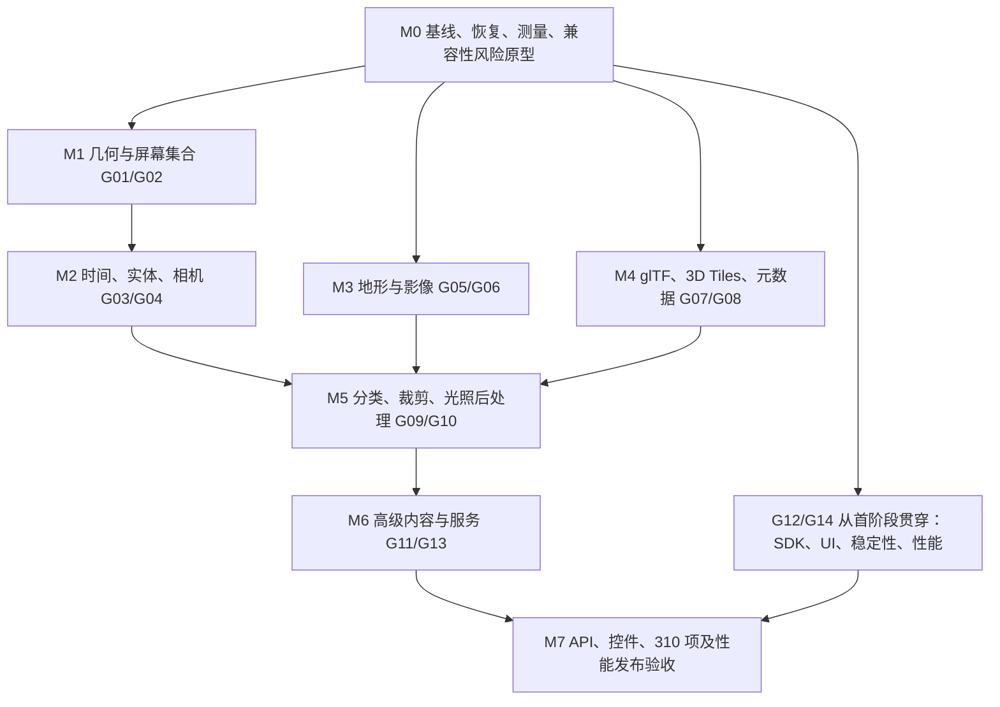

# Cesium Rust 项目现状与完整复刻路线（2026-10-21）

本次结论：项目已形成 Rust / wgpu 原生与 WebGPU 双端的基础地球引擎，已有 **57 / 309 个固定源码案例功能通过，剩余 252 个**。下一阶段应先补稳定性、通用运行时和性能测量，再按依赖补齐功能。57 个案例是重要的回归资产，但 **18.45% 仅是案例比例，不是 API、渲染或整个引擎完成度**。

本文是基于当前代码的后续执行计划；不表示其中的待办已实现。开发目录为 `cesium-rust/`，上游参考目录为 `../cesium/`。保留原实施方案作为架构背景，本文更新其优先级、范围与验收规则。任务范围按本次“完整复刻各类功能”的要求扩展，不能继续把原方案中的“按需求增加动画、扩展”当作最终交付边界。

- [剩余 252 项逐案例排期及本地上游增量](sandcastle-backlog-2026-10-21.md)
- [原实施方案](../Cesium_Rust_Implementation_Plan.md)
- [能力声明](capabilities.json)、[当前案例清单](../tests/sandcastle/full-recipes.json)、[历史验收汇总](full-recipes-validation.json)

## 1. 分析基线与本次验证

### 1.1 两个上游版本必须分别管理

| 项目 | 本次读取结果 | 后续处理 |
| --- | --- | --- |
| Rust workspace / npm | `0.0.26` | 保持现有实现和案例证据 |
| 工具链 / 图形依赖 | Rust `1.99.0`，wgpu `=30.0.1`，winit `=0.30.12` | 固定 lockfile、工具链、wasm-bindgen 与浏览器版本 |
| 309 项历史案例基线 | Cesium `1.146`，`b8d3a36fe98a3e432eb89253c95d5f20e605e0f1` | 后文的 57 / 309、252 均按此基线 |
| 当前 `../cesium` | package.json `1.146.0`，HEAD `77d30241863d30f299e7271a22f95b7d589c1c75`，工作区干净 | 同版本号不等于同源码；另建增量验收 |
| 当前上游 gallery | **310 项** | 新增 `3d-tiles-bounding-box-tests-dev`，不偷偷改写旧分母 |
| 同名案例源码变化 | `3d-models`、`voxels-in-3d-tiles` | 分别增加 glTF 2.1 Unlit Box、3D Tiles 2.0 体素选项；全量复刻当前本地源码时必须补验 |

对比两个提交，Git 报告 194 个文件变化，且 glTF 工具代码迁移到 `packages/gltf`。因此不仅要对比案例，还要对比公共 API、引擎实现、Specs 和资源。最终交付同时要求旧 309 项回归与当前本地 310 项清单通过；当前版本的 57 项仅源码未变化，不能据此宣称新版运行时已重验。

当前 `cesium-rust/` 目录不在 Git 工作树内，而 `../cesium/` 是独立仓库。后续应把 Rust 源码纳入版本管理，或至少生成完整源码/lockfile 快照哈希，使每份运行和性能证据绑定确切源码；WASM 哈希一致本身不能证明它由眼前源码重新构建。

### 1.2 证据强度

1. **本次直接核对**：`full-recipes.json` 有 57 个唯一 `functional-passed` 案例；309 个来源 `main.js` 均在本地镜像；当前 WASM 的 SHA-256 与浏览器历史报告一致，为 `c1e503409bc5865b9430d0acce9a2864d0af789c7364ebd4029dc95d77cd8a79`。4 个 `engine-reference.json` 引用文件与本地上游哈希匹配。
2. **历史报告记录**：115 项普通 Rust、85 项 GPU、8 组 Node、57 个浏览器案例、62 个桌面 90 帧配置通过。浏览器是明确配置的 Vulkan / SwiftShader，使用本地确定性影像；这是软件栅格器上的 WebGPU 功能证据，不是真实硬件性能结论。
3. **本次重新执行**：Controls、SDK lifecycle、Terrain lifecycle、Image resources、Camera SDK、Full recipes 共 6 组 Node 检查通过；最后一项重新提取并核对了 57 份固定源码的案例输入。
4. **本次未完成的复测**：`npm test` 在 workbench 遇到缺少 `jsdom`；单独执行 sandcastle 检查亦缺该包。`cargo test --locked --offline --workspace` 因本地缺 `chrono` 索引/依赖缓存而未进入编译。未运行新的 GPU、浏览器、原生构建或性能测试。此次为文档分析，未为复测下载全部依赖，不能把环境缺依赖记成代码测试失败，也不能把历史通过记成本次通过。

`catalog.json` 的 309 条 `status` 均为 `not-verified`，它是来源目录；通过状态在 `full-recipes.json` 中，现有 UI 也分别读取两者。不能直接统计 catalog.status 得出“0 个完成”。M0 应生成唯一汇总视图，并保留来源目录与验收证据的分工。

本次完整性审计还确认：309 份原源哈希匹配固定提交，其中 6 份本地副本经既有生成器脱敏，`sourceRedacted=true`，副本与原始 `sourceSha256` 不应直接相等；按生成器的脱敏规则比对通过。后续记录器增加 `originalSourceSha256 / sanitizedSourceSha256` 双哈希，避免把合法脱敏误判成源码漂移。57 项 source/fixture/实际输入/浏览器记录与桌面日志链一致；这只是已有证据的完整性检查，不替代重新运行 GPU。

## 2. 代码现状与主要缺口

### 2.1 已有工程资产

当前有 6 个主要 crate：math、formats、tiles、streaming、renderer、viewer，另有 asset-inspector。`crates/` 下 50 个 Rust/WGSL 文件合计约 22,175 行（包含测试），并非原方案中所有拟建 crate 已存在。viewer 承载实体、几何、时间、相机、地形、影像和双端宿主，多条能力线已耦合到其中。

当前上游 `.js` 文件粗清点：core 181、engine 980、gltf 26、widgets 54；engine 内含 Scene 497、Core 272、DataSources 109、Workers 53、Renderer 46。文件数只用于提示审计范围，不能用作移植率分母；Shaders、资源和类型声明须另外纳入。

| 功能域 | 已有实现依据 | 尚需完成的主要能力 |
| --- | --- | --- |
| 数学、精度 | `cesium-math/src/lib.rs`：WGS84/ECEF/ENU、f64 相机相对变换、Reverse-Z | 通用椭球/投影、正交/2D/Columbus、完整交集/样条/参考坐标变换、天文时间与姿态 |
| 地球与地形 | viewer 的 `imagery.rs`、`terrain.rs`：全球影像、Terrarium/quantized-mesh、祖先回退、缓存高程 | 多 provider 完整协议、availability/扩展、稳定接缝、真实动态贴地、地下与水面、异步最高精度采样 |
| 几何与 Primitive | Entity、静态 GeometryInstance、挤出/孔洞、轮廓、像素宽折线及 57 项回归 | PolylineVolume、部分椭球、完整 ST、通用 Appearance/PrimitiveCollection、动态更新与地面分类 |
| 屏幕实体 | Point、Billboard、Label、距离属性、屏幕偏移、alpha-aware pick | atlas/批处理、复杂字体整形/回退/SDF、全参数、聚类、真实贴地、动态图像与视频 |
| 实体与数据源 | 静态 GeoJSON、CZML 子集、显隐/upsert、采样位置、简单 Clock | Property 图、Reference/Composite/Callback/interval、DataSource 生命周期、KML/KMZ/GPX/TopoJSON、完整 CZML |
| 时间与相机 | `clock.rs`、`camera_control.rs`：Unix 秒、飞行/取消/lookAt/跟随 | JulianDate/TAI/UTC/闰秒、参考系、路径和方向插值、完整相机控制/多视图/模式切换 |
| glTF | formats：静态三角形 GLB、五类纹理、UV0/1、sparse、MASK/BLEND | 外链 glTF/buffer/image、动画/skin/morph、压缩、实例、PBR 扩展与 IBL；当前源码明确拒绝若干能力 |
| 3D Tiles | 显式单内容树、外部树、ADD/整组 REPLACE、预算和 pinned LRU | pnts/i3dm/cmpt、多内容/隐式树、viewerRequestVolume、完整 metadata/style、点云/矢量/高级流式 |
| 渲染 | `cesium-renderer/src/lib.rs` + `mesh.wgsl`：GGX+ambient、线性混合、整数 ID、共享 alpha 覆盖 | 真实太阳/IBL、OIT、阴影/大气/HDR/后处理/MSAA、通用裁剪、GPU 批处理/剔除 |
| 平台与加载 | 原生工作线程、Web 有界 fetch、epoch/abort 子集、surface 重配 | 统一资源/取消/重试/缓存、Web Worker、完整设备重建、长期内存与真实硬件验收 |
| SDK/UI | 薄 JS SDK、案例工作台、部分相机/实体/DOM 控件 | CesiumJS 公共 API 适配、完整 Viewer/widgets、事件/Promise 行为、可访问性、错误模型 |

### 2.2 已定位的结构与性能风险

以下为源码观察或优化假设，**尚无本机 profile 证明哪个是当前第一瓶颈**。

| 观察位置 | 当前行为 | 风险与处理 |
| --- | --- | --- |
| renderer `Renderer::new/render` | object uniform 固定 4096 slots，超限报错 | 场景规模硬上限；改分页动态 uniform，再引入实例/storage 路径，保留有界预算 |
| renderer `render` | 每帧逐对象 `queue.write_buffer`，重建 draw Vec 并排序 | 批量打包写入、复用 scratch；相机相对矩阵仍随相机更新，不能错用“全部静态不更新” |
| renderer `upload_material` | 每 mesh 建 VB/IB/material bind group，纹理逐槽上传 | 共享纹理、sampler、材质/几何句柄与实例化；保留影像已有共享路径 |
| renderer `render/pass` | 逐 mesh draw；不透明没有材质分桶；透明按 mesh 中心排序 | 降低状态切换；透明相交仍需 OIT，不能以合批改变透明语义 |
| viewer `set_entities/upsert_entities` | 几何生成与 GPU 上传集中在场景更新 | 大集合导入尖峰；Worker 编译、增量 dirty 更新、分帧提交并保留原子替换语义 |
| `bindings/web/sdk.js` 的 frame | 持续 RAF + 选择/加载/渲染；异常后停止续排 | 增加 requestRender 脏标记和恢复状态机；时间与异步任务不能随渲染休眠失效 |
| renderer 设备回调 | 已注册 lost/uncaptured error，但转成错误消息 | 不能写成“没有 lost 检测”；缺的是重新申请设备、资源重建和继续呈现 |
| `cesium-streaming` | budget/token/pinned LRU 基础；淘汰排序扫描 | 统一内容 generation 与取消；实际规模 profile 后再替换 LRU 数据结构 |
| `clock.rs` / `label.rs` | 明确是 Unix 秒时钟与单字体静态纹理 | 时序案例与大量标签扩展不能只加 JSON 字段，需通用运行时 |
| CI | 已有 Rust/Node/GPU smoke workflow | 无本次 CI 运行证据；browser job 未直接运行 `test:recipes:web`，需完整案例与真实硬件通道 |

## 3. “完整复刻”的完成定义

最终目标以**固定上游源码的可观察功能、公共接口、数据语义及可比较的视觉结果**为准。Rust 内部使用合适的数据结构，GPU 使用 wgpu/WGSL；不要求复制 Cesium 的 WebGL 内部实现。

必须同时维护四份清单：

| 清单 | 最小记录字段 | 完成条件 |
| --- | --- | --- |
| 案例 | case ID、源码/HTML/资源哈希、全部菜单分支、输入、相机/时钟、交互、依赖、证据 | 固定 309 项全部通过，再合并本地 310 项增量 |
| 公共 API | export + 类/方法/属性/事件/默认值/异常/Promise + 上游 Spec + Rust/JS 映射 | 从 exports/声明/Specs 枚举全部公共契约，逐项测试；未映射项保持 open |
| 数据能力 | 格式/版本/扩展/必需性、合法与非法 fixture、provider 协议 | 解析、变换、材质、元数据、查询及失败行为一致；不能只解析 JSON |
| 性能/稳定性 | 设备、后端、资产、质量、轨迹、分位耗时、预算、恢复 | 第 7 节基线及发布门槛通过；所有优化可回退 |

计划中的清单可分别落到 `docs/api-parity.json`、`docs/format-parity.json`、`docs/performance-baseline.json`，本次尚未创建或声称已完成公共 API 全量枚举。源码中的 private 类用于理解依赖，不逐个当作公共 API 移植。Sandcastle 未展示的 API 和异常分支也必须覆盖。

新增案例的验收顺序：来源冻结 → 通用 Rust 能力 → SDK 接口 → 原案例所有分支 → 独立语义/视觉参考 → 双端与异常检查 → 性能检查 → 记录器提升状态。构建期提取原脚本是 fixture 生成手段，**不是 CesiumJS 运行时 API 兼容的证明**；后续必须增加原脚本经兼容 SDK 实际运行的通道，未知字段/调用不得被静默丢弃。

视觉验收采用固定时间/相机/资源/字体/随机数/分辨率的 Cesium 对照图，检查 silhouette、深度/遮挡、材质、alpha 和拾取一致。颜色与边缘容差按场景校准并记录；不能以单一 SSIM 高分掩盖对象缺失。跨后端不承诺逐像素相同，但每项差异须解释、量化并决定是否阻塞。

### 无法直接映射的接口也必须留下工作项

- `material-with-custom-glsl`、CustomShader、PostProcess GLSL：建立 GLSL/Cesium 内建函数到受控 IR/WGSL 的适配层及诊断；不能把仅接受 WGSL 宣称为原 API 完整兼容。先覆盖仓库全部 shader fixture，再扩大受支持语言范围。
- `shared-context` 的 WebGLContext 与 WebGPU Device 不能直接共享原 API 对象。需验证浏览器桥接/合成路线的图层、深度和交互契约；仅做到同 canvas 视觉叠加时标记“替代实现”，不能标完整通过。该接口精确兼容性在 M0 做可行性原型，风险保持显式。
- DOM、Timeline 等浏览器控件在 Web 提供原行为，原生提供等价控件和平台映射；不能拿桌面地球 smoke 替代 DOM 验收。
- ion/Google/ArcGIS/iTwin 等外部服务按客户端能力复刻，服务端不属于本地引擎实现。无凭据/授权资产时标为 `blocked-external`，本地合约 fixture 通过与真实服务通过分别计数；不删除案例或把 mock 当作通过。

## 4. 架构演进与功能工作包

### 4.1 先拆模块，按依赖再拆 crate

保留现有六 crate 路径和测试入口。先把 renderer 拆为 device/capabilities、resources、uploads、pipelines、draw-list、passes、picking、metrics，把 viewer 的 scene、time/property、geometry、terrain、imagery、platform 拆清责任。每次只搬一条可回归边界，不做一次性重写。

最终依赖方向：`math/time → geometry/formats/metadata → tiles/terrain/imagery/entities → scene → renderer/platform → viewer/SDK`。这是职责流向，不能让 formats 反向依赖 renderer；编译后的 CPU 资产与 GPU residency 分离，Scene 以句柄持有资源，设备恢复不需要重新解析全部业务对象。后续独立 geometry、time、gltf、metadata、scene、platform crate 时保留兼容 re-export。

资源身份统一为规范化 URL/内容哈希 + provider/auth scope + variant；内容、场景、设备分别有 generation。异步结果只有通过 generation 验证才可提交；缓存 key 不写入明文 token。瓦片、地形、影像共用请求和预算基础设施，保持各自 LOD 与覆盖语义。

### 4.2 全功能工作包（对应逐案例附录）

下表列出的“完成”均指计划目标，不是当前状态。每个工作包还需纳入未在案例出现的公共 API 与上游 Specs。

| 包 | 目标与上游定位（相对 `../cesium/`） | Rust 实施重点 / 出口 |
| --- | --- | --- |
| G01 几何/材质/Primitive | `packages/core/Source/*Geometry*`；engine `Scene/Primitive*`、`Appearance*`、`Material.js` | 完整顶点属性、孔洞/嵌套/ST/挤出、PolylineVolume 拐角、partial ellipsoid、批次更新、通用材质默认值；几何/颜色/ID 同步 |
| G02 屏幕集合 | engine `Scene/BillboardCollection.js`、`LabelCollection.js`、`TextureAtlas.js`、DataSources visualizer | Atlas、实例化、字体整形/回退/SDF、距离/方向/深度参数、聚类；大量标签不再逐标签纹理/绘制 |
| G03 Entity/时间/数据源 | core `JulianDate`/Clock/插值；engine `DataSources/` | Property 求值图/dirty 依赖、TAI/UTC、interval/reference/callback、orientation/path、CZML 增量、GeoJSON/TopoJSON/KML/KMZ/GPX 与导出 |
| G04 场景/相机/投影 | engine `Scene/Camera*`、`ScreenSpaceCameraController`、`SceneTransitioner`、SceneMode | 完整 camera/frustum、3D/2D/Columbus/morph、惯性/碰撞/地下、多视图同步、VR/stereo、事件和坐标转换 |
| G05 地形/贴地 | engine `Scene/QuadtreePrimitive`、`GlobeSurfaceTile*`、Core terrain providers、GroundPrimitive | quantized-mesh 全链路、availability/normals/water mask、相邻 LOD、夸张/地下、async height、动态贴地和地表材质；3D Tiles terrain 单独对接 G08 |
| G06 影像/provider | engine `Scene/ImageryLayer*`、各 ImageryProvider | 多图层顺序/alpha/调色/split/cutout、投影/重投影、WMS 版本轴序、WMTS 时间/矩阵集/pickFeatures、厂商协议/attribution、panorama/video 资源路径 |
| G07 模型/glTF | engine `Scene/Gltf*`、`Scene/Model/`；当前本地 `packages/gltf/` | 外链资源、accessor/拓扑、animation/skin/morph、node/articulation、Draco/meshopt/KTX2、实例、IBL 与完整材质扩展；上游支持扩展逐项清点 |
| G08 Tiles/metadata/style | engine `Scene/Cesium3DTile*`、Implicit*、Metadata*、Expression、PointCloud* | 旧容器与现代 GLB、多内容/隐式子树、binary BatchTable/hierarchy、EXT_mesh_features/instance_features/structural_metadata、样式表达式、点云/动态点云、S2/bounds；覆盖不破洞 |
| G09 裁剪/分类/查询 | engine Clipping*、Classification*、Picking、TerrainPicker、snapping 相关模块 | 平面/多边形裁剪、分类 stencil/等价 pass、depth pick/drillPick/ray/mostDetailed/clamp/sampleHeight、snapping、深度与 feature ID 一致 |
| G10 光照/后处理/自定义渲染 | engine Scene/OIT/ShadowMap/PostProcessStage*、Atmosphere/Sky*、Shaders | HDR/IBL/太阳月亮星空/大气雾云、阴影、OIT、MSAA/FXAA、SSAO/bloom/DOF/轮廓、Fabric/CustomShader/后处理适配 |
| G11 高级内容/效果 | engine GaussianSplat*、Voxel*、Vector3DTile*、ParticleSystem、I3S* | 高斯排序/LOD、体素 sparse brick/传递函数/拾取、矢量、粒子、I3S 子层/属性/坐标；每类独立预算与测试 |
| G12 Viewer/工具/宿主 | `packages/widgets/Source/`、engine Widget、Resource/信用信息 | Viewer/CesiumWidget、Timeline/Animation、Geocoder/选择/InfoBox/Inspector、无 Viewer 用法、共享宿主、生命周期与 API 兼容 |
| G13 外部服务/组合场景 | gallery 中 ion、AEC、iTwin、Google 等及其 provider | 在 G05–G11 能力上完成真实资源、鉴权/续期、元数据查询和业务交互；各服务使用离线契约和授权实网双验收 |
| G14 调度/性能 | engine RequestScheduler、TaskProcessor、Tileset traversal/cache、Scene.requestRenderMode | Web Worker、背压/取消/重试、SSE/预测预取/缓存、按需渲染、实例/间接绘制、长期稳定性；优化方案见第 6 节 |

glTF 扩展至少按上游 loader 清点 unlit、texture transform、quantization、Draco/meshopt/Basis、GPU instancing、feature/metadata、PBR specular/IOR/clearcoat/sheen/transmission/volume/iridescence/anisotropy/emissive strength 等的实际支持范围。这里的名称是待审计入口，不能直接作为本项目“支持列表”；本地新增 glTF 2.1 与 Tiles 2.0 也按具体提交实现和 fixture 审计，不自行宣称标准已正式定版。

## 5. 实施顺序与近期可执行批次

### 5.1 里程碑依赖

这是工程依赖图，不是要求同时启动多个代理。单人可依此串行执行；团队可在接口稳定后分工。G05 的地表贴合与 G09 分类、G07 的 IBL 与 G10 光照存在集成依赖，不能仅因某包排在前面就提前宣布全部结束。

各阶段表示主开发窗口，不要求包内所有交叉案例在此时结束：先交付下游需要的基础接口，带后置依赖的案例保留 open，进入联合验收。这样不会出现“必须先完成全部 G01 才能开发 G03，但 rectangle 又依赖 G03”的循环门槛。最终所有包与案例在 M7 统一闭环。

| 阶段 | 优先级 | 出口门槛 |
| --- | --- | --- |
| M0 | P0 | 两版本基线分开、57 项可重验、设备恢复原型通过、性能数据可采集、GLSL/shared-context 风险有决策 |
| M1 | P1 | G01/G02 基础几何/集合接口与已解锁案例通过；新几何有独立参考；后置动态/分类案例保留 open；规模入口不触发原 4096 硬上限 |
| M2 | P1 | G03/G04 通用属性/时间/生命周期契约和模式切换通过；静态与动态实体共用运行时；依赖模型/高级数据的案例继续跟踪 |
| M3 | P1 | G05/G06 provider、地形/影像质量与覆盖、基础贴地及网络故障验收；分类/Tiles terrain 联合案例交后续集成 |
| M4 | P1 | G07/G08 基础格式/扩展/metadata/style 全链路、CPU/GPU/网络预算和遍历无洞；高级光照/分类留联合验收 |
| M5 | P1 | G09/G10 视觉/深度/查询/多 pass 一致，关闭效果时可靠降级 |
| M6 | P2 | G11/G13 各内容类型与组合案例、授权实网验收；外部阻塞单独列出 |
| M7 | 发布门槛 | 旧 309 项 + 当前 310 项、公共 API/Specs、性能/稳定性/平台矩阵全部关闭；剩余替代实现不能伪装成精确兼容 |

不沿用原方案的固定 44 周作为承诺。M0 建立 API/扩展数量与真实缺口后，按工作包三点估算；先完成两个小批次测量实际吞吐，再滚动估算。高级分类/体素/高斯和服务集成的工作量远大于基础几何案例，不能按“每批 6 个”线性推算 252 项工期。

### 5.2 下一批：0.0.27 稳定性与性能底座（案例数量不强增）

| 顺序 | 具体任务 | 主要文件/拟新增模块 | 验收 |
| --- | --- | --- | --- |
| 1 | 恢复锁定环境，自动审计 source/fixture/WASM/evidence；保存上游两个 SHA | scripts、CI、docs | 57 项证据与输入对应；npm 8 组与 Rust 测试可复现；catalog 与通过清单不混淆 |
| 2 | 设备诊断与状态机 `Running → Lost → Recreating → Rehydrating → Running/Failed` | renderer device；viewer native/web；sdk | 注入丢失/销毁/resize，旧提交/拾取失效；重建成功可继续显示/加载；失败有可恢复 UI |
| 3 | 最小 CPU FrameStats、可选 GPU timestamp、分配/上传/请求计数 | renderer metrics；scene；SDK diagnostics | 固定 3 条相机轨迹可导出 p50/p95/p99 与能力信息；无 timestamp 时显示 unavailable |
| 4 | uniform 批量写入与 slots 分页；复用帧 scratch | renderer draw-list/resources | 57 项颜色/ID 回归；新增 4095/4096/4097 与 1 万轻量对象规模检查，无越界或 ID 混淆 |
| 5 | requestRender 脏标记与事件唤醒 | scene、sdk RAF、native event loop | 静止无时变状态时停止 GPU 提交；输入/下载/动画/回调/resize 能唤醒，无黑屏或漏更新 |
| 6 | GLSL 适配、shared-context 最小可行性验证；API inventory schema | SDK/shader adapter 设计与 tests | 明确哪些可精确适配、哪些需桥接及后续成本；未解决项保留 open |

设备恢复先覆盖现有 57 项及已支持的 tiles/terrain/imagery，后续新增资源都必须实现重建描述。`set_device_lost_callback` 已有，不能再用“接入回调”代替恢复任务。默认浏览器后端的历史故障须获取真实 adapter/error scope/最小复现并定位；恢复机制与根因修复分别验收。

### 5.3 后续三个功能批次

| 建议批次 | 固定 case ID | 实施重点 | 全部验收后累计（仅规划） |
| --- | --- | --- | --- |
| 0.0.28 | `czml-rectangle`、`partial-ellipsoids` | 原 CZML 的四个矩形、stripe/相对图片资源、透明/rotation/outlineWidth/加载取景；partial ellipsoid 的 innerRadii/cone/clock、HPR orientation 与封边；不得因已有完整椭球跳过裁切面 | 59 / 309 |
| 0.0.29 | `polyline-volume`、`polyline-volume-dev`、`polyline-volume-outline-dev`、`czml-polyline-volume` | 独立 3D 截面扫掠；圆/矩形/星形、miter/bevel/round、cap/normal/ST/outline；不得复用屏幕宽线冒充体积 | 63 / 309 |
| 0.0.30 | `polygon-texture-coordinates-dev`，并启动 G02 atlas 公共能力 | 逐顶点与嵌套孔洞 ST、跨日期线/极区、独立上游几何结果与图片采样；atlas 工作不自动增加案例数 | 64 / 309 |

特别调整：`rectangle` 原脚本包含 `CallbackProperty` 动态 rotation/stRotation 与 `ClassificationType.TERRAIN`，不是纯静态矩形。它留在 G01 归属，但须等待 G03/G09 所需能力后结项，不列入 0.0.28 的两个目标。`volumes-dev` 实际是 EllipsoidPrimitive 的 RimLighting/Stripe 材质与悬停拾取，归 G01，不归体素。

随后按 G02 逐项完成 billboards/labels/distance 等案例，再推进 G03 通用 Property。每批数量是候选范围，若原脚本存在当前计划未识别的行为，先补依赖再提升状态，不能删原菜单来达到数量目标。现有已通过案例仍固定为 57，本次没有更改验收状态。

## 6. wgpu 渲染与性能优化方案

所有方案以锁定 wgpu **30.0.1** 为 API 基准；下面是结合现有代码的工程设计。默认基础路径必须支持 WebGPU；原生增强通过能力协商启用，不用“原生可用”推导浏览器可用。

### 6.1 能力分层与设备恢复

| 路径 | 能力 | 降级与限制 |
| --- | --- | --- |
| B 基础 | CPU 选择、普通 indexed draw、分页 dynamic uniform、共享材质、实例绘制 | 保留为正确性参考路径；查询实际 limits、格式与 attachment 能力 |
| C 通用 GPU 加速 | compute 可见性、storage 实例表、固定槽 indirect、RenderBundle、按需 MSAA/HDR | 每项单独验证 limits/usage/格式；indirect 基线 first_instance=0，避免强制非零能力 |
| N 原生增强 | variable-count multi-draw、绑定数组、持久化管线缓存等 | 逐项申请 feature；不支持时回到 B/C，不能启动失败或改变显示内容 |

wgpu 的 `MULTI_DRAW_INDIRECT_COUNT` 为原生可选特性；`PIPELINE_CACHE` 在该版本文档列出 Vulkan 支持，不能承诺 Metal/Web 同样获得持久化驱动缓存。普通 Rust HashMap 管线对象复用不需要这个 feature。`TIMESTAMP_QUERY` 可用于 pass 边界计时，任意 encoder/pass 内时间戳另有特性要求。[wgpu Features 30.0.1](https://docs.rs/wgpu/30.0.1/wgpu/struct.Features.html)

设备丢失后提高 device epoch，停止引用旧 GPU 资源，保留 CPU 数据和逻辑句柄；重新协商设备/格式/尺寸，重建 pipeline、attachments、atlas、驻留资源，按预算分帧恢复。surface Lost/Outdated 的重配与 device lost 的整设备重建分开；连续失败进入有退避的 Failed 状态，不能无限重试占满主线程。以锁定 API 的回调和错误域收集诊断。[wgpu Device](https://docs.rs/wgpu/30.0.1/wgpu/struct.Device.html)

### 6.2 CPU 提交、uniform 与实例

1. 将当前每对象一次 `write_buffer` 改为按页打包：`ObjectUniform` 实际 **144 bytes**，按 `min_uniform_buffer_offset_alignment` 对齐；不能照搬旧方案的 128 bytes。每页统一上传，处理 max_buffer_size、binding size 与 u32 dynamic offset 边界。相机变化需重新计算 camera-relative 变换，材质未变无需重建 bind group。
2. 不透明 draw 按 pass → pipeline → material → geometry 分桶，并在收益允许时按前后深度优化 overdraw；透明排序独立。用稳定 handle/ID 维持拾取映射，不能把排序下标当作持久 feature ID。
3. 相同 geometry/material 的 Entity、billboard、point、模型使用实例数据；screen quad/line strip 与复杂 mesh 分路径。处理负缩放、双面、alpha、feature、distance 条件，不为合批丢失语义。
4. 对命令结构稳定的批次尝试 RenderBundle：相机只改绑定缓冲内容；资源句柄、动态 offset、管线、目标格式/sample count/设备变化要失效重录。高频流入流出场景可能重录成本更高，保留 A/B 开关。[RenderBundle](https://docs.rs/wgpu/30.0.1/wgpu/struct.RenderBundle.html)

### 6.3 资源、上传与内存

- 纹理去重 key 包含源资源身份、色彩语义、格式、mip 与视图；sampler 单独缓存，材质按因子/纹理句柄复用。相同图片被当作 baseColor 和 normal 时不能错误共享 sRGB 语义。已有 globe/imagery 共享路径纳入统一记账。
- 建立 `CPU decoded → UploadPending → Submitted → Resident → Retiring` 状态。每帧同时限制上传字节、任务数和 CPU 编码时间；“一内容/帧”无法限制单个大纹理尖峰。几何/纹理/mip 可分段，在完整可绘制前保留父瓦片/旧实体集。
- 小写入先使用 Queue；大量细碎写入评测 StagingBelt，使用 `finish → submit → recall` 生命周期或该版本的合并辅助接口。不要每帧分配/销毁 staging，也不要在主循环等待映射。[StagingBelt](https://docs.rs/wgpu/30.0.1/wgpu/util/struct.StagingBelt.html)
- buffer→texture copy 的行距按接口要求补齐 256；Queue::write_texture 不套用同一行距限制；压缩块、层数、mip 另行校验。[TexelCopyBufferLayout](https://docs.rs/wgpu/30.0.1/wgpu/struct.TexelCopyBufferLayout.html)
- 同时记网络压缩字节、解码 CPU、staging、GPU 几何/纹理/mip、attachments、atlas、待回收页。淘汰只解除逻辑驻留，GPU 命令完成前不能把池内同一区域交给新内容；共享资源使用引用计数/代际句柄。
- 纹理压缩按 BC/ETC2/ASTC 实际能力选转码结果；缺少压缩能力时走有预算的 RGBA 回退。atlas/texture_2d_array 与 binding array 不混为一谈；动态图集注意 mip bleeding、padding 与被引用字形淘汰。

### 6.4 选择、可见性与 GPU-driven

先优化 CPU 的保守视锥/地平线剔除、紧致 bounds、SSE 滞回和稳定优先队列，再比较 compute。GPU 剔除仅处理**已驻留可画内容**，CPU 保留网络请求、ADD/REPLACE 覆盖、祖先 pin 与元数据状态。

第一版 compute 输出固定槽的 `DrawIndexedIndirect`，不可见项 `instance_count=0`；不每帧读回数量。后续实例压缩表、prefix-sum 和 multi-draw 在 profiling 证明提交瓶颈后加入。批次仍按 pipeline/material 分组，不能一条 indirect 跨任意管线。非零 first_instance 需独立特性支持；原生 variable-count 路径不可成为 Web 必选项。[RenderPass 间接绘制接口](https://docs.rs/wgpu/30.0.1/wgpu/struct.RenderPass.html)

Hi-Z 放在稳定基础剔除之后：当前 Reverse-Z 下保守完全遮挡层级需考虑区域最远遮挡深度（min reduction，空白为 0），不能直接套常规深度的 max 公式。包围体投影要保守，跨 near plane、相机瞬移、刚可见/刚加载对象应回退为可见；只让不透明可靠遮挡物参与，处理上一帧遮挡滞后。用 CPU/关闭遮挡路径与快速相机轨迹证明无误剔除，再评价收益。

### 6.5 地形、瓦片与加载性能

参考本地 `Cesium3DTilesetBaseTraversal/SkipTraversal/MostDetailedTraversal`、`QuadtreePrimitive`、`GlobeSurfaceTileProvider`，逐项实现 SSE/动态 SSE、foveated 优先级、移动节流、预测预取、加载兄弟节点策略和缓存溢出预算。参数含义进入 API parity；测试以覆盖、质量与收敛时间为主，不要求 Rust 请求顺序与 JS 内部完全一样。

统一每 host 并发、优先级、去重、取消、超时、429/5xx 退避、Retry-After、负缓存与鉴权续期；错误不永久污染可重试内容。原生执行器与 Web Worker 共享任务协议。Web 用 transferable buffer 控制复制，SharedArrayBuffer/线程 WASM 仅在部署隔离条件满足时启用，不作为基础要求。

地形网格复用索引拓扑、缓存解码结果、按像素误差细化；裙边/边界约束/LOD morph 防裂缝，影像与地形 LOD 独立并保持祖先 UV。预取只能用剩余预算，不能挤掉当前可见覆盖。高程查询使用独立 mostDetailed 请求契约，避免无限细化占满交互队列。

### 6.6 多 pass、画质与移动端带宽

从当前显式 pass 演进为可描述读写依赖的 FramePlan：可选 shadow → opaque terrain/model → classification/depth → translucency/OIT → atmosphere/particles → post-process → screen/UI；具体大气/透明位置按 reference 场景拆分，不能固定顺序掩盖遮挡错误。Pick 维持按需、独立单采样 ID/depth，复用材质裁剪条件。

- HDR 中间色使用适配器支持的可渲染/混合格式；tone map 一次，sRGB 编码一次。MSAA 的附件/管线/resolve 统一，ID pass 不参与颜色 resolve。
- 实现与上游场景相符的 OIT，先采用经验证的加权混合方案并保留排序降级；强透明交叠、透射体须单独验证，近似 OIT 不能被声明成精确透明解法。
- CSM/PCF 阴影处理 Reverse-Z、bias、级联稳定、太阳与模型接收；静态阴影仅在光源/遮挡物/相关视区变化时更新。
- IBL 的 diffuse irradiance/specular 预过滤/BRDF LUT、色调曝光与 PBR 扩展作为 G07/G10 共同契约。大气 LUT/体积云有独立质量档，低档仍保留必要功能语义。
- 后处理优先合并兼容步骤，按需要的分辨率运行，复用生命周期不重叠的暂存纹理；不读回整帧实现屏幕效果。不再读取的 attachment 设 Discard，但下游需要的 depth/color 必须 Store。
- Apple/移动 tile GPU 重点测 attachment 带宽、load/store 和 pass 数；深度预通道、compute 剔除不总是更快，由设备实测决定。动态 resolution/SSE/阴影质量采用显式自适应模式，固定质量性能对比时关闭。

### 6.7 标签、粒子、点云、体素、高斯

标签改共享 glyph atlas + 实例 quad，布局缓存以字体/字号/整形/样式为 key；颜色/位置变化不触发重新光栅化，字体回退和国际文本单独测试。聚类按屏幕空间与相机 dirty 更新，保留 cluster 事件和成员拾取语义。

点云用分块量化位置、点大小衰减和 feature ID；GPU 解码/可见性与预算结合。粒子使用固定时间步、实例 billboard、可选 compute 更新，确定性 seed 可重放。体素用有界 brick cache、空块跳过、层级采样/early termination 和异步 metadata 查询。高斯要同时预算解码/投影/排序/alpha overdraw，评测 GPU radix sort 与必要的 CPU 回退；LOD 和排序误差分别验收。不能仅把它们画成普通三角形就视为功能完成。

## 7. 性能基准、测试与发布门槛

### 7.1 基准设计

目前没有可引用的本机性能基线。以下数字均为**初始工程目标**，M0 在固定设备实测后校准并冻结，不是已取得成绩。

| 基准 | 场景/轨迹 | 必须采集 |
| --- | --- | --- |
| B0 | 地球静止 30 秒、连续缩放/旋转 | idle 提交次数、CPU、input→present、requestRender 唤醒 |
| B1 | 1k/4k/10k 同材质与多材质对象；10k 屏幕标注 | draw/bind/write 次数、几何/文字构建、CPU 编码、GPU、内存 |
| B2 | 冻结地形+影像，全球→城市→地表→回程 | SSE、裂缝/空洞、首次可见/目标质量时间、重复下载、上传尖峰 |
| B3 | 城市 3D Tiles、室内/BIM；冷/热缓存 | traversal、请求/解码队列、coverage、纹理共享率、驻留/淘汰 |
| B4 | 动画/skin、交叠透明、PBR/阴影/HDR 后处理 | 分 pass GPU、图像差异、透明次序、皮肤更新与 shader 变体 |
| B5 | 点云/体素/高斯/粒子固定中大型资产 | 排序/compute/填充率、可见数、分块缓存、交互拾取延迟 |
| B6 | 30 分钟漫游，切换资源/resize/恢复循环 | p99、峰值与稳态内存、重试/取消/旧结果、device loss 恢复 |

先使用当前合法本地 fixture，模型/点云等尚未支持的场景在对应里程碑加入；文件清单与 SHA 固定。Native 与 Web 分别测，CesiumJS 对比使用相同硬件、资源、视口、DPR、相机时间与可比画质；报告差异，不拿 SwiftShader 对硬件或低 SSE 质量对高质量。

测量流程：release 构建、固定设备/驱动/电源/后端；功能预热后固定轨迹运行至少 60 秒，至少 3 次，冷缓存和热缓存分开。CPU 阶段耗时、GPU 时间和用户看到的帧间隔分别报告，不能用 CPU submit 耗时代替 GPU。GPU query resolve/copy/map 使用环形延迟读回，不阻塞同一帧；报告 GPU 时间戳不可用的设备。

### 7.2 初始门槛与优化收益判定

| 项目 | 拟定验收目标 |
| --- | --- |
| 中等场景交互 | 指定桌面/笔记本参考设备，1080p、DPR=1、冻结质量：帧间隔 p95 ≤ 16.7 ms、p99 ≤ 33.3 ms；GPU 工作耗时单列 |
| 资源导入 | 重任务分片；Web 主线程不因一次解码/上传持续阻塞 >50 ms；CPU 上传编码初始预算 2 ms/帧，另设字节上限并实测调整 |
| 静态节能 | 完全静止、无待处理任务/时变效果时，稳定后 10 秒内不产生新的无意义 GPU render submit；诊断更新不强制绘制 |
| 内存 | 有硬预算和背压；示例初值 CPU decoded 512 MiB、GPU 驻留 512 MiB、staging 32 MiB，attachments 另计且设总额；低端配置下调 |
| 长稳 | 同轨迹重复后缓存进入平台期；在显式清空并完成 GPU 回收后，无持续累计的资源/监听器/任务；不能只靠 RSS 瞬时值判泄漏 |
| 优化采纳 | 同质量下 p95/CPU 编码/显存等目标指标有超出噪声的收益，其他主要指标回退 ≤5% 或有明确可接受说明；保留关闭开关 |
| 正确性 | 不减少可见内容、不错拾取、不跳过原脚本分支、不以降低画质伪装提速；跨日期线/极区/近裁面/相机瞬移必须通过 |

如 M0 显示参考设备无法达到初值，先记录基线和原因，再版本化修改目标/设备档位；不能测试之后无记录地放宽阈值。基准资产规模、设备型号、可接受画质须在 performance manifest 固定，未固定前性能承诺不成立。

### 7.3 验证层级与平台

- 数学/格式：对应上游 Specs 的正常、边界、非法输入；property-based / fuzz 覆盖长度、索引、递归、URL、压缩和 metadata，限制内存/时间。
- GPU：WGSL/layout/动态 offset、depth/alpha、负缩放、mip、1×1 非对齐读回、ID；CPU 与 GPU 剔除差分。
- 案例：固定源码的所有菜单/按钮/事件/时间分支，独立 Cesium 对照、原生和浏览器证据、WASM 与输入哈希绑定。
- 平台：macOS Metal（含当前开发机）、Windows DX12、Linux Vulkan；Web 在实际启用 WebGPU 的 Chromium 与目标 Safari/Firefox 版本上探测验证，未支持的浏览器明确报能力不足。SwiftShader 只保留确定性功能 CI。
- 生命周期：destroy/recreate、零尺寸、连续 resize、后台恢复、慢网/断网/429/超时、取消后迟到、设备丢失；无旧 epoch 数据进入新场景。
- 发布：309 基线与当前 310 清单、公共 API/格式清单、真实服务状态、长期轨迹、版权与资源 attribution、功能降级说明共同审查。

## 8. 执行规则与文档维护

每个任务以工作包 + 案例 ID/API ID 追踪，状态建议为 `planned / implementing / blocked-dependency / blocked-external / functional-passed / parity-passed`。已有 `functional-passed` 不自动升级为 API/视觉 parity。完成时记录源码哈希、实际范围、验证命令/设备/结果和已知差异；平台不适用必须说明，不能一律写 passed。

本文为当前执行路线；原 951 行实施方案保留技术背景，其“从零开始”、旧模块示意与最初周数不再描述当前进度。`development-status.md`、各 batch validation 保留历史，后续新增结果只在有证据时更新。当前两份原方案正文相同，后续建议维护一个正文与一个链接入口，避免长期漂移。

本次文档检查：252 个待办 ID 唯一且恰好等于 catalog 减去通过集合；14 个工作包数量之和为 252；新增文档与两份原方案入口的本地 Markdown 链接存在，代码围栏闭合。原方案只新增入口提示，未修改历史正文；没有更改引擎代码、依赖或案例通过状态。

最先执行 M0 的环境和证据审计、设备恢复、FrameStats。完成底座后推进 0.0.28–0.0.30，同时按附录认领其余案例。最终只有案例、公共 API、数据语义、视觉、稳定性与性能全部完成，才宣称“完整复刻”；本次交付的是分析与计划，不改变 57 / 309 的已完成事实。
